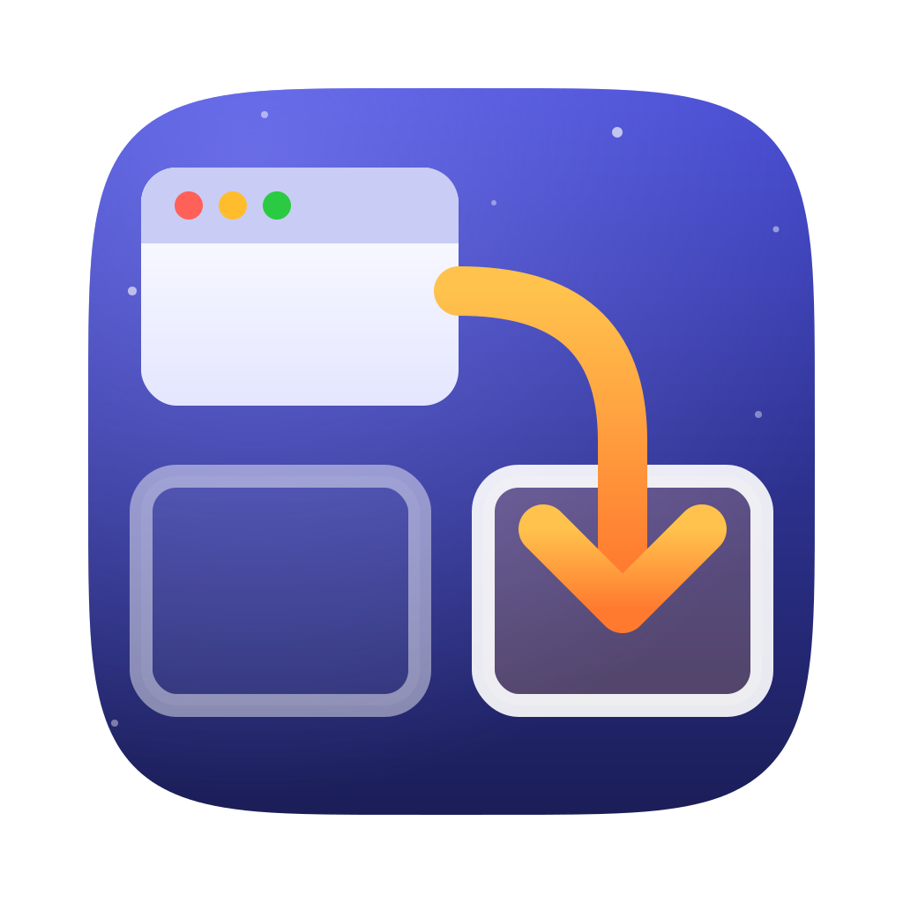
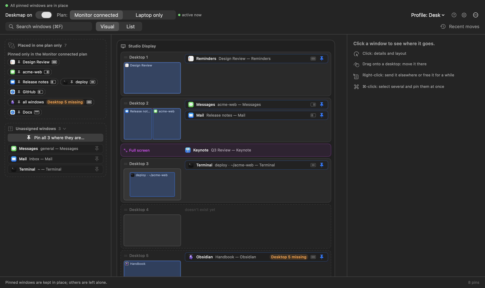
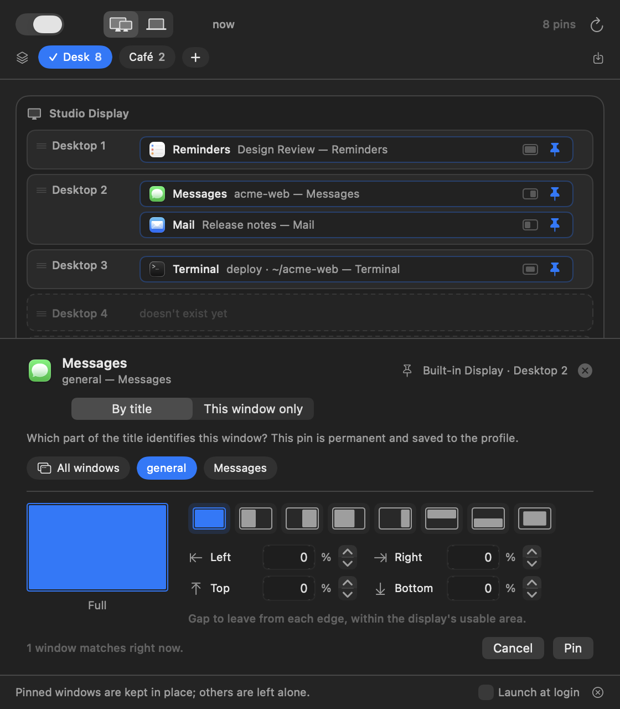
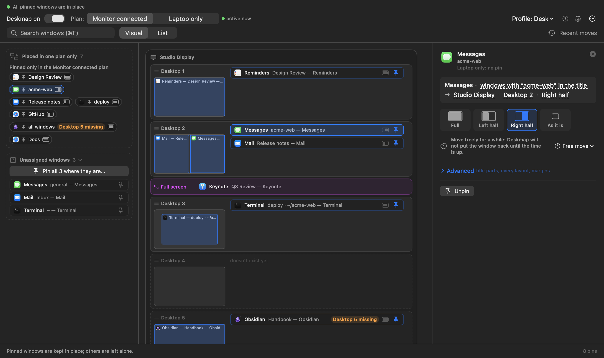
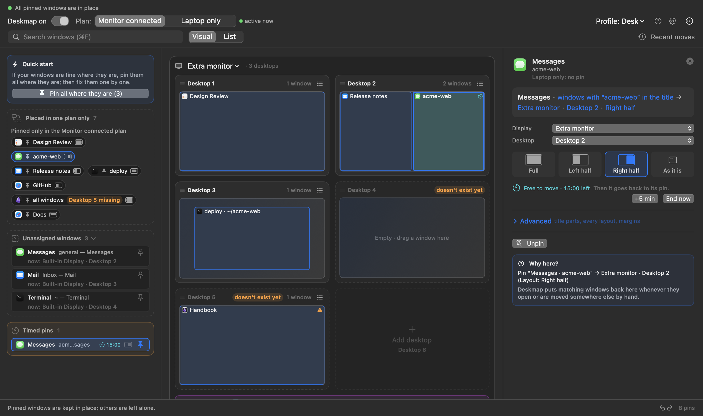
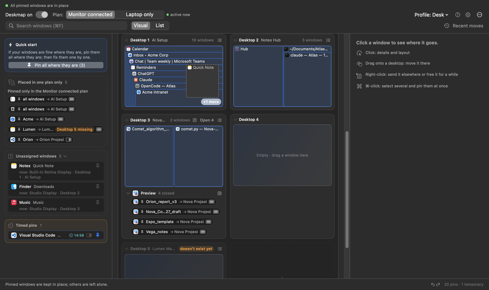

  

<h1 align="center">Deskmap</h1>

  <b>Every window on the right display, the right desktop, in the right layout. Every time.</b>

  
  
  
  
  
  

  
   
  ▶ Radiohead, <i>Everything In Its Right Place</i>

---

> [!NOTE]
> **This is a vibe-coded project.** Deskmap was written by AI coding agents in
> Claude Code. I directed the work and use the app every day, but I have not
> read every line.
>
> **Models used:** Claude Opus 5.5, Claude Opus 5, Claude Fable 5.1, Claude
> Sonnet 5 and Claude Haiku 4.5.

Pin a window once. From then on it lives on that display, that desktop
(Space), in that layout: when it opens, when it wanders off, and when you plug
in or unplug a monitor.

<table>
  <tr>
    <td width="50%" align="center"></td>
    <td width="50%" align="center"></td>
  </tr>
  <tr>
    <td align="center"><b>The map</b></td>
    <td align="center"><b>Pin by title</b></td>
  </tr>
  <tr>
    <td width="50%" align="center"></td>
    <td width="50%" align="center"></td>
  </tr>
  <tr>
    <td align="center"><b>Layouts</b></td>
    <td align="center"><b>Free move</b></td>
  </tr>
  <tr>
    <td colspan="2" align="center"></td>
  </tr>
  <tr>
    <td colspan="2" align="center"><b>Open a workspace at once</b></td>
  </tr>
</table>

## Features

- **Pin by window title.** Two VS Code workspaces or two Safari tab groups can
  live in two different places. Or pin the whole app, or just one window.
- **Display, desktop and layout in one pin.** Draw the area on a grid, pick a
  preset, or set a fixed size.
- **Two setups.** *Monitor connected* and *Laptop only* have separate targets.
  Plug in or unplug, and every window moves to its place.
- **The map.** Every display, every desktop, every window. Drag a window to move
  it. Add, remove and reorder desktops.
- **Open or close a workspace at once.** One click opens every closed pinned
  window of a desktop, each in its place; per app, close or reopen all its
  pinned windows there (say, every Excel window of a project).
- **Free move.** Let a pinned window roam for 1 to 60 minutes; then it goes
  home. Also from a right-click on the menu bar icon.
- **Profiles.** *Office*, *Home*, *Café*: switch with a click.
- **Automatic backups.** Every profile, pin and desktop name is backed up
  hourly (kept a day), daily (kept a week) and weekly (kept forever), inside
  the app. Restore any of them from Settings › Backups; undoable.
- **Undo instead of dialogs.** Multi-step ⌘Z / ⇧⌘Z and a session history of
  settings changes (Recent moves › Changes) you can jump back or forward in.
- **Automation.** `deskmap://` URLs for Shortcuts, Raycast or a terminal.
- **One small app.** No scripts, no config file, no dependencies; System
  Integrity Protection stays on. Nothing is collected or sent.

## How it compares

| | **Deskmap** | macOS | Rectangle Pro | Moom | Stay | ShiftPlus | yabai | AeroSpace | Hammerspoon |
|---|:-:|:-:|:-:|:-:|:-:|:-:|:-:|:-:|:-:|
| Rules match the **window title**, not just the app | ✅ | ❌ | ✅ | 🟡 | ✅ | ❌ | ✅ | ✅ | 🟡 |
| Sends a window to a chosen **native desktop** (Space) | ✅ | 🟡 | ❌ | ❌ | ❌ | 🟡 | ✅ | ❌ | 🟡 |
| …with System Integrity Protection left on | ✅ | ✅ | — | — | — | 🟡 | ✅ | — | 🟡 |
| Separate targets per **display setup** | ✅ | ❌ | 🟡 | ✅ | ✅ | ❌ | ❌ | ❌ | 🟡 |
| Re-places windows when a display is **plugged in or unplugged** | ✅ | ❌ | ✅ | ✅ | ✅ | ❌ | 🟡 | 🟡 | 🟡 |
| Routes **new windows** as they open | ✅ | 🟡 | ✅ | ❌ | 🟡 | ❌ | ✅ | ✅ | 🟡 |
| **Size and position** per rule | ✅ | ❌ | ✅ | 🟡 | ✅ | 🟡 | ✅ | 🟡 | 🟡 |
| **Map** of every display and desktop; drag a window to assign it | ✅ | 🟡 | ❌ | ❌ | ❌ | ❌ | ❌ | ❌ | ❌ |
| **Temporary pin** for one window | ✅ | ❌ | ❌ | ❌ | ❌ | ❌ | 🟡 | ❌ | 🟡 |
| **Timed free move** for a pinned window | ✅ | ❌ | ❌ | ❌ | ❌ | ❌ | ❌ | ❌ | 🟡 |
| Switchable **profiles** | ✅ | ❌ | ✅ | 🟡 | 🟡 | ✅ | ❌ | 🟡 | 🟡 |
| **Automation** from outside (URL, AppleScript or CLI) | ✅ | 🟡 | ✅ | ✅ | 🟡 | 🟡 | ✅ | ✅ | 🟡 |
| No config file or script to write | ✅ | ✅ | ✅ | ✅ | ✅ | ✅ | ❌ | ❌ | ❌ |

✅ built in · 🟡 partly, or with a limitation (see the notes) · ❌ not available · — does not apply (the tool does not move windows between desktops)

Rectangle Pro and Stay come closest, but neither moves a window to another
desktop. yabai does, from a shell script. The map, temporary pins and timed
free move are built into none of them.

<b>Notes and sources</b> (checked on 30 September 2026 against each product's own documentation)

- **macOS** ([Spaces](https://support.apple.com/guide/mac-help/work-in-multiple-spaces-mh14112/mac),
  [tiling](https://support.apple.com/guide/mac-help/tile-app-windows-mchlef287e5d/mac)).
  *Dock › Options › Assign To* pins a whole app, not a window, to the desktop
  you are on; you cannot choose a desktop by number, and a new window follows
  only its app's assignment. Mission Control shows one desktop's windows at a
  time and a drag there is a one-off move. Shortcuts has *Move Window* and
  *Resize Window* actions, but there are no rules to trigger.
- **Rectangle Pro** ([layouts](https://rectangleapp.com/pro/docs/layouts/),
  [URL scheme](https://github.com/rxhanson/RectanglePro-Community)). Layout
  entries match by title and can apply when a window opens or when a chosen
  display connects or disconnects. Those are triggers per display event, not
  setups stored side by side. It does not move windows between desktops.
- **Moom 4** ([custom actions](https://manytricks.com/moom/help/customactions.html),
  [AppleScript](https://manytricks.com/moom/help/applescript.html)). Saved
  layouts are snapshots: windows are matched by title only when a layout is
  applied, the geometry is the saved frame, and a window opened later is not
  routed. Layouts can trigger on a display configuration. Several named
  layouts exist, but no profiles that group rules.
- **Stay** ([overview](https://cordlessdog.com/stay/),
  [title patterns](https://cordlessdog.com/stay/documentation/window-title-pattern-matching/),
  [preferences](https://cordlessdog.com/stay/documentation/general-preferences/)).
  Stores window frames per display combination and restores them when
  displays change; titles are matched with regular expressions. Windows are
  restored when their app launches, but a window opened later in a running
  app is not routed. The stored sets follow the display setup; there are no
  profiles you switch yourself. Automation is basic AppleScript and hot keys.
- **ShiftPlus** ([Spaces](https://shiftplus.app/blog/stop-macos-rearranging-spaces/),
  [displays](https://shiftplus.app/blog/mac-windows-rearrange-external-monitor/),
  [Raycast extension](https://www.raycast.com/nghia_luong/shiftplus)). A
  workspace is restored by hotkey: apps are launched on their assigned Space,
  and an app already on the wrong Space is quit and relaunched after asking;
  open windows are not moved. Arrangement presets are per app, applied on
  restore. Automation is a Raycast extension.
- **yabai** ([manual](https://github.com/asmvik/yabai/blob/master/doc/yabai.asciidoc),
  [changelog](https://github.com/asmvik/yabai/blob/master/CHANGELOG.md)).
  Rules match titles by regular expression and send windows to a Space with a
  grid position. Moving windows between Spaces works with System Integrity
  Protection on since 7.1.25 (May 2026) on recent macOS; older systems need
  the scripting addition. Display signals fire, but re-placing is a script
  you write. `--one-shot` rules apply once to the next matching window; they
  are not tied to one window. Everything is configured from the command line.
- **AeroSpace** ([guide](https://nikitabobko.github.io/AeroSpace/guide),
  [commands](https://nikitabobko.github.io/AeroSpace/commands)). Uses its own
  virtual workspaces instead of native desktops. `on-window-detected` rules
  match titles and run for every new window, in a TOML config. Workspaces are
  re-assigned to monitors on reconnect; single windows are not re-placed.
  Rules choose tiling or floating, not a size or position
  ([#714](https://github.com/nikitabobko/AeroSpace/issues/714)). Binding
  modes switch key sets, not window rules.
- **Hammerspoon** ([hs.spaces](https://www.hammerspoon.org/docs/hs.spaces.html),
  [hs.window.filter](https://www.hammerspoon.org/docs/hs.window.filter.html),
  [hs.layout](https://www.hammerspoon.org/docs/hs.layout.html),
  [hs.screen.watcher](https://www.hammerspoon.org/docs/hs.screen.watcher.html)).
  A scripting framework: every 🟡 means "possible if you write the Lua".
  Nothing here works out of the box, and moving windows between Spaces is
  reported unreliable on macOS 15 and later in released builds
  ([#3889](https://github.com/Hammerspoon/hammerspoon/pull/3889)).

Products change. If something here is out of date, open an issue.

## Install

**[Download the latest release](https://github.com/cnkndmr/Deskmap/releases/latest)**,
unzip it and drag `Deskmap.app` to `/Applications` (macOS 13 or later, Apple
silicon and Intel). On macOS 15 and 26.0–26.3 moving windows between desktops
has not been verified, so it starts off there (displays and layouts still
work); the app shows a card with **Try Anyway**.

The app is not notarized, so macOS blocks the first launch. Open it once,
then go to System Settings › Privacy & Security and click **Open Anyway**.
After that, click **Grant Access** and turn on **Deskmap** under
Accessibility. macOS asks for this permission again after each update.

To build from source: `make app` (needs the Xcode Command Line Tools).

## Documentation

[User guide](docs/guide.md) ([Türkçe](docs/kilavuz.md)) ·
[Reference](docs/reference.md) ·
[Architecture](docs/architecture.md) ·
[Privacy](docs/privacy.md) ·
[Changelog](CHANGELOG.md)

## Good to know

- Moving a window to another desktop uses private macOS functions. An update
  can break them; Deskmap then falls back to display and layout only and
  tells you.
- Full-screen windows are left alone.
- [All limitations](docs/reference.md#limitations)

## License

MIT; see [LICENSE](LICENSE).
