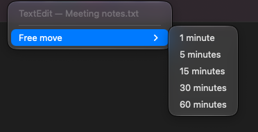

<p align="center">
  
</p>

<h1 align="center">Deskmap</h1>

<p align="center">
  <b>Every window on the right display, the right desktop, in the right layout. Every time.</b>
</p>

<p align="center">
  
  
  
  
  
  
</p>

---

You open your laptop at a desk, plug in the monitor, and spend the next two
minutes dragging windows back to where they were. Deskmap does that for you.

Pin a window once. From then on it lives on that display, that desktop
(Space), in that layout: when it opens, when it wanders off, and when you
plug in or unplug a monitor. Pins match the **window title**, so two VS Code
workspaces or two Safari tab groups can live in two different places.

One menu bar app. No scripts, no config file, no helper program, and System
Integrity Protection stays on.

<table>
  <tr>
    <td width="50%" align="center"></td>
    <td width="50%" align="center"></td>
  </tr>
  <tr>
    <td align="center"><b>The map</b><br><sub>One card per display, one row per desktop, every window where it lives.</sub></td>
    <td align="center"><b>Pin by title</b><br><sub>Pick the part of the title that names the workspace; choose a layout.</sub></td>
  </tr>
  <tr>
    <td width="50%" align="center"></td>
    <td width="50%" align="center"></td>
  </tr>
  <tr>
    <td align="center"><b>Layouts</b><br><sub>Drag an area on the grid, pick a preset, or set a fixed size.</sub></td>
    <td align="center"><b>Free move</b><br><sub>Let a pinned window roam for a while; it goes home when the time is up.</sub></td>
  </tr>
</table>

## What it does

### Pin

- **By title.** Pick the part of the title that names the project, workspace
  or tab group. Every window that carries it goes to the same place.
- **By app.** *All windows* pins the whole app, whatever the title says.
- **This window only.** A temporary pin for one window; it ends when the
  window closes and leaves no rule behind.
- **Most specific wins.** A pin with more title parts beats a broader one, so
  "all of Safari here, but the *Work* tab group there" just works.

### Place

- **Display, desktop and layout in one pin.** The window is kept on its
  desktop and gets its size and position.
- **Draw the layout.** Drag an area on a grid shaped like the real display,
  or pick a preset: halves, 70/30, corners; thirds and quarters on ultrawide
  displays.
- **Fixed size.** 1400 × 900 points at a corner, an edge or the center, the
  same on every display.
- **Use current size and position.** Arrange the window by hand, press one
  button, and that becomes the pin's layout.

### Two setups

- **Monitor connected** and **Laptop only** are separate. Each pin has its own
  target in each.
- **Plug in, unplug: everything moves.** Deskmap waits for the displays to
  settle and places every pinned window again. No hotkey, no "restore".

### The map

- **See everything.** One card per display, one row per desktop, every open
  window on its row. Full-screen spaces are shown too.
- **Drag to move.** Drag a row to another desktop or another display. A pinned
  window's pin follows; an unpinned window just moves once.
- **Opens on the window you were using.** Click the menu bar icon and that
  window is already selected, its panel open.
- **Nothing gets lost.** *Unassigned windows* lists what has no pin yet; the
  menu bar icon shows how many.
- **Manage desktops from the map.** Add one, remove one, drag to reorder.

### Let go for a while

- **Free move.** Give a pinned window 1 to 60 minutes of freedom. Move it,
  resize it, take it to another desktop; when the time is up it goes home.
- **Right-click the menu bar icon** to start a free move for the window in
  front, without opening the map.

  

- **Pause** everything with one switch.

### Everything else

- **Profiles.** Named sets of pins: *Office*, *Home*, *Café*. Switch with a
  click; export and import as a file.
- **Undo instead of dialogs.** No "Are you sure?". Every destructive action
  shows *Undo* for ten seconds (⌘Z).
- **Automation.** `deskmap://` URLs for Shortcuts, Raycast, Keyboard Maestro
  or a terminal: apply, pause, switch profile, add or remove a desktop.
- **Light.** One `.app`, no dependencies, about 0.2 % CPU at idle.
- **Private.** Nothing is collected, nothing is sent. Pins live in one JSON
  file on your Mac.
- **English and Turkish.**

## How it compares

Deskmap is not a tiling window manager and not a snapping tool. It answers
one question: *where does this window live?* The table lists what Deskmap
does and whether other tools do the same.

| | **Deskmap** | macOS | Rectangle Pro | Moom | Stay | ShiftPlus | yabai | AeroSpace | Hammerspoon |
|---|:-:|:-:|:-:|:-:|:-:|:-:|:-:|:-:|:-:|
| Rules match the **window title**, not just the app | ✅ | ❌ | ✅ | 🟡 | ✅ | ❌ | ✅ | ✅ | 🟡 |
| Sends a window to a chosen **native desktop** (Space) | ✅ | 🟡 | ❌ | ❌ | ❌ | 🟡 | ✅ | ❌ | 🟡 |
| …with System Integrity Protection left on | ✅ | ✅ | — | — | — | 🟡 | ✅ | — | 🟡 |
| Separate targets per **display setup** | ✅ | ❌ | 🟡 | ✅ | ✅ | ❌ | ❌ | ❌ | 🟡 |
| Re-places windows when a display is **plugged in or unplugged** | ✅ | ❌ | ✅ | ✅ | ✅ | ❌ | 🟡 | 🟡 | 🟡 |
| Routes **new windows** as they open | ✅ | 🟡 | ✅ | ❌ | 🟡 | ❌ | ✅ | ✅ | 🟡 |
| **Size and position** per rule | ✅ | ❌ | ✅ | 🟡 | ✅ | 🟡 | ✅ | 🟡 | 🟡 |
| **Map** of every display and desktop; drag a window to assign it | ✅ | 🟡 | ❌ | ❌ | ❌ | ❌ | ❌ | ❌ | ❌ |
| **Temporary pin** for one window | ✅ | ❌ | ❌ | ❌ | ❌ | ❌ | 🟡 | ❌ | 🟡 |
| **Timed free move** for a pinned window | ✅ | ❌ | ❌ | ❌ | ❌ | ❌ | ❌ | ❌ | 🟡 |
| Switchable **profiles** | ✅ | ❌ | ✅ | 🟡 | 🟡 | ✅ | ❌ | 🟡 | 🟡 |
| **Automation** from outside (URL, AppleScript or CLI) | ✅ | 🟡 | ✅ | ✅ | 🟡 | 🟡 | ✅ | ✅ | 🟡 |
| No config file or script to write | ✅ | ✅ | ✅ | ✅ | ✅ | ✅ | ❌ | ❌ | ❌ |

✅ built in · 🟡 partly, or with a limitation (see the notes) · ❌ not available · — does not apply (the tool does not move windows between desktops)

**In short.** Rectangle Pro and Stay come closest on window titles and
display changes, but neither moves a window to another desktop. yabai does
move windows between desktops by rule, but it is set up in a shell script and
has no display setups. Hammerspoon can be scripted to do most of this; you
write and maintain the Lua. The map, temporary pins and timed free move are
built into none of them.

<details>
<summary><b>Notes and sources</b> (checked on 30 September 2026 against each product's own documentation)</summary>

- **macOS** ([Spaces](https://support.apple.com/guide/mac-help/work-in-multiple-spaces-mh14112/mac),
  [tiling](https://support.apple.com/guide/mac-help/tile-app-windows-mchlef287e5d/mac)).
  *Dock › Options › Assign To* pins a whole app, not a window, to the desktop
  you are on; you cannot choose a desktop by number, and a new window follows
  only its app's assignment. Mission Control shows one desktop's windows at a
  time and a drag there is a one-off move. Shortcuts has *Move Window* and
  *Resize Window* actions, but there are no rules to trigger.
- **Rectangle Pro** ([layouts](https://rectangleapp.com/pro/docs/layouts/),
  [URL scheme](https://github.com/rxhanson/RectanglePro-Community)). Layout
  entries match by title and can apply when a window opens or when a chosen
  display connects or disconnects. Those are triggers per display event, not
  setups stored side by side. It does not move windows between desktops.
- **Moom 4** ([custom actions](https://manytricks.com/moom/help/customactions.html),
  [AppleScript](https://manytricks.com/moom/help/applescript.html)). Saved
  layouts are snapshots: windows are matched by title only when a layout is
  applied, the geometry is the saved frame, and a window opened later is not
  routed. Layouts can trigger on a display configuration. Several named
  layouts exist, but no profiles that group rules.
- **Stay** ([overview](https://cordlessdog.com/stay/),
  [title patterns](https://cordlessdog.com/stay/documentation/window-title-pattern-matching/),
  [preferences](https://cordlessdog.com/stay/documentation/general-preferences/)).
  Stores window frames per display combination and restores them when
  displays change; titles are matched with regular expressions. Windows are
  restored when their app launches, but a window opened later in a running
  app is not routed. The stored sets follow the display setup; there are no
  profiles you switch yourself. Automation is basic AppleScript and hot keys.
- **ShiftPlus** ([Spaces](https://shiftplus.app/blog/stop-macos-rearranging-spaces/),
  [displays](https://shiftplus.app/blog/mac-windows-rearrange-external-monitor/),
  [Raycast extension](https://www.raycast.com/nghia_luong/shiftplus)). A
  workspace is restored by hotkey: apps are launched on their assigned Space,
  and an app already on the wrong Space is quit and relaunched after asking;
  open windows are not moved. Arrangement presets are per app, applied on
  restore. Automation is a Raycast extension.
- **yabai** ([manual](https://github.com/asmvik/yabai/blob/master/doc/yabai.asciidoc),
  [changelog](https://github.com/asmvik/yabai/blob/master/CHANGELOG.md)).
  Rules match titles by regular expression and send windows to a Space with a
  grid position. Moving windows between Spaces works with System Integrity
  Protection on since 7.1.25 (May 2026) on recent macOS; older systems need
  the scripting addition. Display signals fire, but re-placing is a script
  you write. `--one-shot` rules apply once to the next matching window; they
  are not tied to one window. Everything is configured from the command line.
- **AeroSpace** ([guide](https://nikitabobko.github.io/AeroSpace/guide),
  [commands](https://nikitabobko.github.io/AeroSpace/commands)). Uses its own
  virtual workspaces instead of native desktops. `on-window-detected` rules
  match titles and run for every new window, in a TOML config. Workspaces are
  re-assigned to monitors on reconnect; single windows are not re-placed.
  Rules choose tiling or floating, not a size or position
  ([#714](https://github.com/nikitabobko/AeroSpace/issues/714)). Binding
  modes switch key sets, not window rules.
- **Hammerspoon** ([hs.spaces](https://www.hammerspoon.org/docs/hs.spaces.html),
  [hs.window.filter](https://www.hammerspoon.org/docs/hs.window.filter.html),
  [hs.layout](https://www.hammerspoon.org/docs/hs.layout.html),
  [hs.screen.watcher](https://www.hammerspoon.org/docs/hs.screen.watcher.html)).
  A scripting framework: every 🟡 means "possible if you write the Lua".
  Nothing here works out of the box, and moving windows between Spaces is
  reported unreliable on macOS 15 and later in released builds
  ([#3889](https://github.com/Hammerspoon/hammerspoon/pull/3889)).

Products change. If something here is out of date, open an issue.

</details>

## Install

Deskmap is built from source; there is no download yet.

```sh
git clone https://github.com/cnkndmr/Deskmap.git
cd Deskmap
make app                           # release build → build/Deskmap.app
cp -R build/Deskmap.app /Applications/
open /Applications/Deskmap.app
```

You need macOS 13 or later and the Xcode Command Line Tools
(`xcode-select --install`).

On first launch, click **Grant Access** and turn on **Deskmap** under System
Settings › Privacy & Security › Accessibility. Deskmap also checks four
Mission Control settings and tells you which one to change
([details](docs/reference.md#required-macos-settings)).

## Your first pin

1. Click the menu bar icon. The window you were using is already selected.
2. Choose the part of its title that identifies it, and a layout if you want
   one.
3. Press **Pin**.

That window, and every later window with that title, now goes to this
desktop in this layout. Switch to the other setup with ⌘1 / ⌘2 and pin it
there too.

## Documentation

| | |
|---|---|
| [User guide](docs/guide.md) · [Türkçe kılavuz](docs/kilavuz.md) | Setup and your first pins in ten minutes |
| [Reference](docs/reference.md) | Every rule, setting, URL command, shortcut and failure mode |
| [Architecture](docs/architecture.md) | How the engine works and what is stored where |
| [Privacy](docs/privacy.md) | Nothing is collected or sent |
| [Distribution](docs/distribution.md) | Signed builds, and why the Mac App Store is not an option |
| [Changelog](CHANGELOG.md) | What changed in each version |

## Good to know

- **Private APIs.** macOS has no public way to move a window to another
  desktop. Deskmap uses private system functions for that, without touching
  System Integrity Protection. A macOS update can break them; Deskmap checks
  every move and, if moves stop working, falls back to display and layout
  only and tells you.
- **Titles must tell windows apart.** If an app shows the same title on every
  window, pin the whole app or use *This window only*.
- **Two setups.** Monitor connected and laptop only. External displays are
  told apart by position, left to right.
- **Full-screen windows are left alone.**
- **Not instant.** Windows are placed on window events, with a light check
  every five seconds for whatever the events miss.

The full list is in the [reference](docs/reference.md#limitations).

## License

MIT; see [LICENSE](LICENSE).
