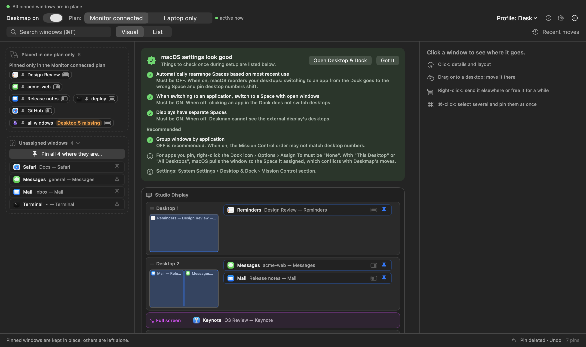
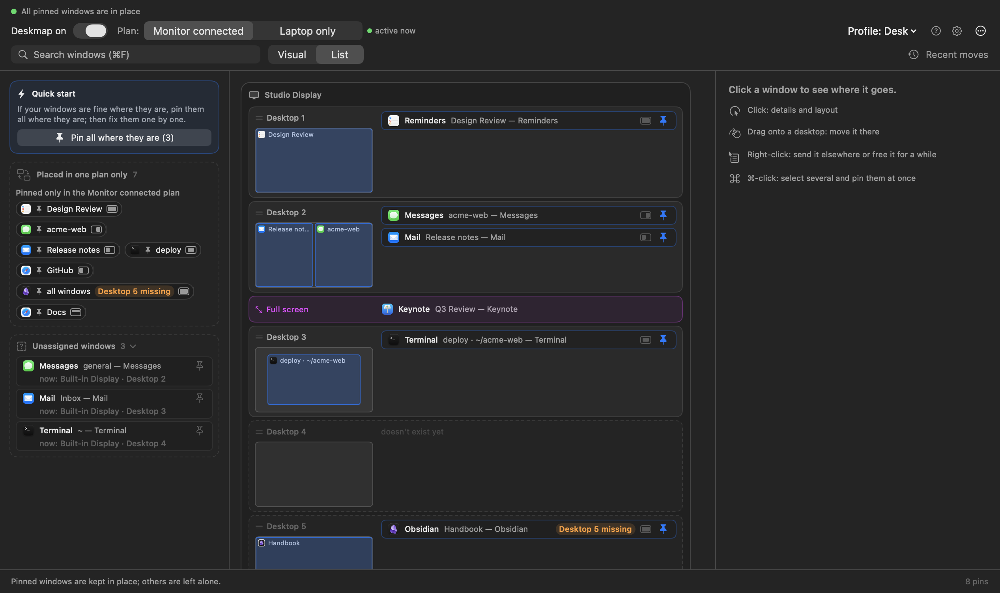
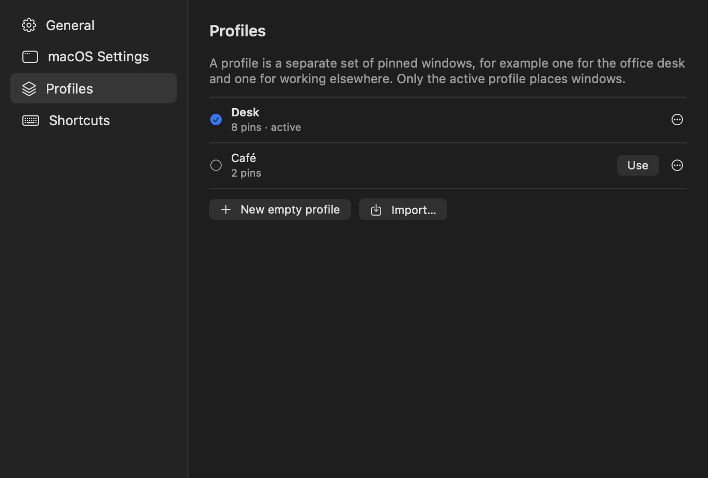

# User guide

Deskmap puts each of your windows on the right display, on the right
desktop, in the right size — and keeps putting it back, without you asking
again.

You tell it once: *"the window with `acme-web` in its title belongs on the
monitor, desktop 2, left half."* From then on it happens by itself: when you
open the app, when you plug the monitor in, when you come back from lunch.

This guide takes about ten minutes. You need macOS 13 or later.

---

## 1. Install and give permission

1. Copy **Deskmap.app** to your Applications folder and open it. It has
   no Dock icon; it lives in the menu bar.
2. The **welcome guide** opens on first launch and walks through three steps.
   Step 1 is the permission: click **Open System Settings and allow**.
3. macOS opens System Settings › Privacy & Security › Accessibility. Turn
   **Deskmap** on; the guide notices it by itself.

   The app needs this to see window titles and to move windows. It reads
   nothing else: no network, no files of yours, no window contents.
4. Step 2 checks the macOS settings below, step 3 asks how to start: **Pin my
   windows where they are** (recommended) or **Start empty**. You can open the
   guide again from **Settings › General**.
5. Open **Settings** (⚙ in the toolbar, or ⌘,) › **General** and turn on
   **Launch at login** so Deskmap is there after every restart.


## 2. Fix four macOS settings (once)

The app checks these live: the welcome guide's second step, the
**Settings › macOS Settings** tab and, if one of them goes wrong later, an
orange card on the map. Click **Open Desktop & Dock** and set:

| Setting | Must be |
|---|---|
| Automatically rearrange Spaces based on most recent use | **Off** |
| When switching to an application, switch to a Space with open windows | **On** |
| Displays have separate Spaces | **On** |
| Group windows by application | Off (recommended) |

One more, which macOS won't let any app check: for every app you are going
to pin, right-click its Dock icon › **Options › Assign To → None**. If macOS
has assigned the app to a desktop itself, it will fight over the window.



## 3. Pin your first window

1. Open the window you care about — say a project in VS Code.
2. Click the menu bar icon. The **map** shows each display with one small
   card per desktop. A card is a mini screen: every window on that desktop
   is a box at its own place and size. A card that gets crowded stacks the
   boxes that cover the same area, each with its title showing, and tucks the
   rest behind a **+3 more**-style button; the **≡** button on a card opens its
   plain list. Looking for one window? Press **⌘F** and type part of its
   name.



   Prefer rows? **List** (next to **Visual**) shows one row per desktop with
   a small preview next to it.
3. Find your window and click its box (or right-click it › **Pin to this
   desktop…**). Its details open in the column on the right. Windows that
   don't belong anywhere yet wait in the *Unassigned windows* box on the
   left, each showing where it is *now*; click one there, or its **pin**
   button.


4. The panel starts with one sentence, for example *Messages · this window
   (general) → Built-in Display · Desktop 2 · Full*. Each blue part is a link
   that opens a menu. The first one offers two choices:
   - **This window (key)** — Deskmap works out a stable key for the window
     and shows it in brackets. In order: the file the window shows (Preview,
     Pages, Word, Excel, TextEdit… — two different `main.pdf` files stay
     apart); otherwise the part of the title that has stayed the same while
     the title changed (VS Code's project folder, Terminal's `user@host`,
     Safari's tab group); before any title change has been seen, a cleaned
     title (page numbers, "Edited", unread counts dropped). The panel tells
     you how many open windows match right now.
   - **All windows of the app**, whatever the title. Good for Mail or Slack.

   If the window has no stable key (every part of its title changes, like a
   Safari window without a tab group) or the key would also match another
   open window, only **All windows** is offered.
5. Click **Pin** (or press ⌘Return).

Under the sentence, the **Display** and **Desktop** menus move the pin
somewhere else, and at the bottom a **Why here?** box says in plain words
which pin put the window there.

Several windows at once: the **Quick start** card at the top of the left
sidebar has **Pin all where they are (N)** (or ⌘-click boxes to pick some);
confirm in the right-hand column. Each one keeps its current desktop, size
and position.

That's a pin. Tomorrow's window with the same file or project, the one after
a restart — same place.

## 4. Move it where it belongs

Drag the window's box (or its chip) onto another desktop's card — on any
display. That is how you say "no, this one lives on the monitor, desktop 3".
You can also use the **Display** and **Desktop** menus in the panel, or
right-click the box › **Send to**. An empty card says *Empty · drag a window
here*; the last card, **+ Add desktop**, adds one to the map.

- Desktops that don't exist yet are drawn with a dashed line. macOS only
  lets *you* create desktops: open Mission Control and add them, then the
  card becomes solid.
- Right-click a card to **Rename Desktop…**, **Remove Name** or **Remove Desktop**.
  Removing a desktop that still has windows asks first and lists the apps
  (macOS then moves those windows to another desktop).
- Pinned windows that are closed right now wait as chips under the card's
  mini screen. **Open N** in the card's header opens all of them at once;
  each one lands in its pinned place.
- An app group (for example all Excel windows on a desktop) has its own
  button at the right of its header: **↗** opens its closed pins, **✕**
  closes all its pinned windows (the app keeps running, unpinned windows are
  left alone, unsaved documents still ask). Works for every app.
- An orange **Desktop 5 missing** badge means the pin wants desktop 5 but the
  display has only 3, so the window waits on the last one (hover it for the
  details).
- Dragging an **unpinned** window moves it once and saves nothing.

## 5. Give it a size

Click a pinned window's box or chip. Under the sentence are four layouts: **Full**,
**Left half**, **Right half** and **As it is** (only the desktop is kept;
Deskmap never moves or resizes the window there). If the window has some
other layout, a fifth tile, **Custom**, shows it, with its full name under the
row. Everything else is under
**Advanced ▸**: the title parts, a grid to drag across, all presets (70/30,
thirds, quarters, top/bottom half, center), a gap to leave from the edges and
a fixed size. Advanced stays open for the next window once you open it.


The layout is applied once per window. After that, resize it however you
like — the app won't keep snapping it back. Press **⌘R** (or **⋯ › Place
pinned windows now**) when you want everything placed again from scratch.

Need to move a pinned window by hand for a while? **Free move** in the panel,
or right-click its box › **Free move** › 5, 15, 30… minutes. Deskmap leaves it
alone until the time is up, then puts it back.

Found a size you like by hand? Click the pinned window, open **Advanced** and
press **Use current size and position**: the window's current place and
size become the pin's layout. The pin stays on its display and desktop.
Undo with ⌘Z if you change your mind.

## 6. Two plans: with monitor, without

Your windows can't live on desktop 3 of a monitor that isn't plugged in. So
every pin has two targets, and the **Plan** switch at the top (**⌘1 / ⌘2**)
shows one or the other. The plan in effect right now is marked **active
now**; the other one says when it applies.

- **Monitor connected** — at least one external display is attached.
- **Laptop only** — just the built-in screen.

With two external monitors the map shows a card for each (**Monitor 1**,
**Monitor 2**). Each monitor keeps its card wherever you place it in System
Settings › Displays; if the two are the wrong way round, click the card title
and pick the other monitor. While Monitor 2 is unplugged its windows wait on
Monitor 1 (Settings › General › **Second monitor missing**).

Set up one, switch, set up the other. When you plug the monitor in or pull
it out, the app waits a couple of seconds for the displays to settle and
then puts every pinned window where that plan says.

A pin you don't want in one of the plans: drag it to the *Placed in one plan
only* box in the left sidebar. It stays in the other plan. To drop a pin that
is listed there for the other plan, click it and use **Unpin in the … plan**.

## 7. Profiles: desk, café, presentation

A profile is a whole set of pins with a name. **Profile: … ▾** in the toolbar
switches between them instantly.



- **Settings › Profiles** lists them: **Use** switches, **⋯** renames,
  duplicates, exports or deletes; **New empty profile** and **Import…** below.
  A new or duplicated profile does not switch on by itself: press **Use**.
- Desktop names belong to the profile that gave them: a new profile starts
  with no names, and renaming a desktop in one profile never changes another.
  See [Desktop names and your monitor](#9-desktop-names-and-your-monitor).
- Export writes a `.deskmap.json` file — that's how you carry your setup
  to another Mac, or share it.
- **Settings › Backups**: Deskmap backs up all profiles, pins and desktop
  names by itself — one copy per hour for the last day, one per day for the
  last week, one per week forever. Click **Restore** on one, then **Replace
  current profiles**; your current state is backed up first, and the map's
  footer offers *Undo* (⌘Z). **Back up now** takes a copy right away.
- **⋯ › Copy the Laptop only plan here** (Monitor connected plan) copies the
  laptop pins *and* the order of the laptop desktops (with their names) into
  the Monitor connected plan; a name that was elsewhere in that plan moves
  with it. Windows are moved to match, but no desktop is removed.

## 8. When you change your mind

- **Undo / Redo**: every settings change is a step. Press **⌘Z** to undo
  and **⇧⌘Z** to redo, or use the ↶ ↷ buttons in the footer. **Recent moves
  › Changes** lists this session's steps; **Return here** on any row jumps
  back (or forward) to it. Almost nothing asks for confirmation; Undo is why. The one exception is
  removing a desktop that still has windows.
- **Recent moves › Window moves** (toolbar): which pinned window Deskmap sent where, and
  when — the answer to "why did my window jump?".
- **Pause**: the **Deskmap on** switch at the top left, or right-click the
  menu bar icon › **Pause for 15 minutes**. Nothing is moved while it is off,
  and the menu bar icon shows a pause sign. Flipping the switch yourself
  during those 15 minutes cancels the timer. A switched-off Deskmap stays off
  after restarts, so if the app ever seems asleep, look there first.
- **?** in the toolbar explains every color and badge on the map.

Right-clicking the menu bar icon also offers **Pin it where it is** for the
front window, the free-move times for a pinned one, the profiles, Settings
and Quit. A left click opens the map.

## 9. Desktop names and your monitor

A name belongs to one physical desktop, not to "desktop 2 on the monitor".
Move the desktop, reorder it in Mission Control, or carry it to the laptop
screen: the name goes with it, and so do the pins that point at the name.

Each setup — **Monitor connected** and **Laptop only** — has its own *plan*:
which names live on which display, in which order, and how many desktops each
display should have. You don't write the plan; it follows what you do: naming
a desktop, dragging a card, reordering or adding desktops in Deskmap or in
Mission Control updates the plan of the setup you are in.

When you plug or unplug the monitor, Deskmap applies the plan of the new setup:

- **Named desktops keep their windows.** Each one is put at its planned place
  and everything on it moves along, pinned or not.
- **Unnamed windows come back.** Windows on an unnamed monitor desktop wait on
  their own laptop desktop (one per former desktop), and return to the monitor
  when you plug it back in.
- **Only empty leftovers are removed.** Desktops that this switch emptied or
  that macOS created on the way are removed if nothing is on them and they are
  beyond the plan. Desktops with windows, named desktops and your own empty
  desktops stay.
- **Missing desktops are created**, up to the plan.
- **No deleted-desktop rows.** A desktop that vanishes because the display
  changed is not a deletion; a row appears only when *you* delete a desktop
  in Mission Control or in Deskmap.

If a window can't be moved, it stays where it is, its desktop is kept and the
footer says so.

**Pin to a name.** The pin panel and the **Send to** menu list names first. A
window pinned to a name follows that desktop wherever it is; if the name has
no desktop yet, the window waits (the map says *waiting for …*) and nothing
is moved. A pin to a name is made for both setups unless the other one already
has a place for the window.

**First launch after the upgrade.** Deskmap first saves your old file (in
`Backups/pre-migration/`, never deleted). Then it matches each name to the
desktop where its pinned windows actually are, and shows a card
**Desktop names upgraded** with what it did: names placed, names without a
desktop yet, wrong deleted-desktop rows removed and their pins restored.
Deskmap does not move a window or remove a desktop in this step. If it found
empty desktops beyond your plan, the card offers **Remove N empty desktops**
(each is checked empty again just before it goes). **Undo upgrade** puts the
old file back (nothing is saved until Deskmap restarts); an older Deskmap can only open the new file read-only.

## 10. One-key setups (optional)

The app answers `deskmap://` links, so anything that can open a URL can
drive it:

```sh
open "deskmap://profile/Café"   # switch profile
open "deskmap://reapply"        # place everything now
open "deskmap://toggle"         # pause / resume
```

Put one in a Shortcut and give it a keyboard shortcut, or trigger it from a
macOS Focus automation: "when Work Focus turns on, switch to the Desk
profile".

## 11. If something doesn't happen

| What you see | What it means |
|---|---|
| Window doesn't move at all | Deskmap is paused (top left), or the Accessibility permission was lost after an app update — grant it again. |
| Window lands on the wrong desktop | "Automatically rearrange Spaces" is on, or the app's Dock **Assign To** isn't **None**. |
| A pin's chip looks faded | Another, more specific pin matches that window first. Hover it to see which. |
| Orange **Desktop 5 missing** badge | That desktop doesn't exist; add desktops in Mission Control. |
| A window jumped and you don't know why | **Recent moves** in the toolbar lists each move and its target. |
| Nothing moves between desktops, but sizes work | This macOS version didn't expose the private calls the app uses for desktops. Displays and layouts still work. |

Longer troubleshooting, the full rules of matching, and the data file
formats are in the [README](../README.md).

---

### The two sentences to remember

**A pin is a promise about a title**: any window whose title contains this
part, from now on, belongs here. **Everything else is drag and drop** — the
map is the app.
