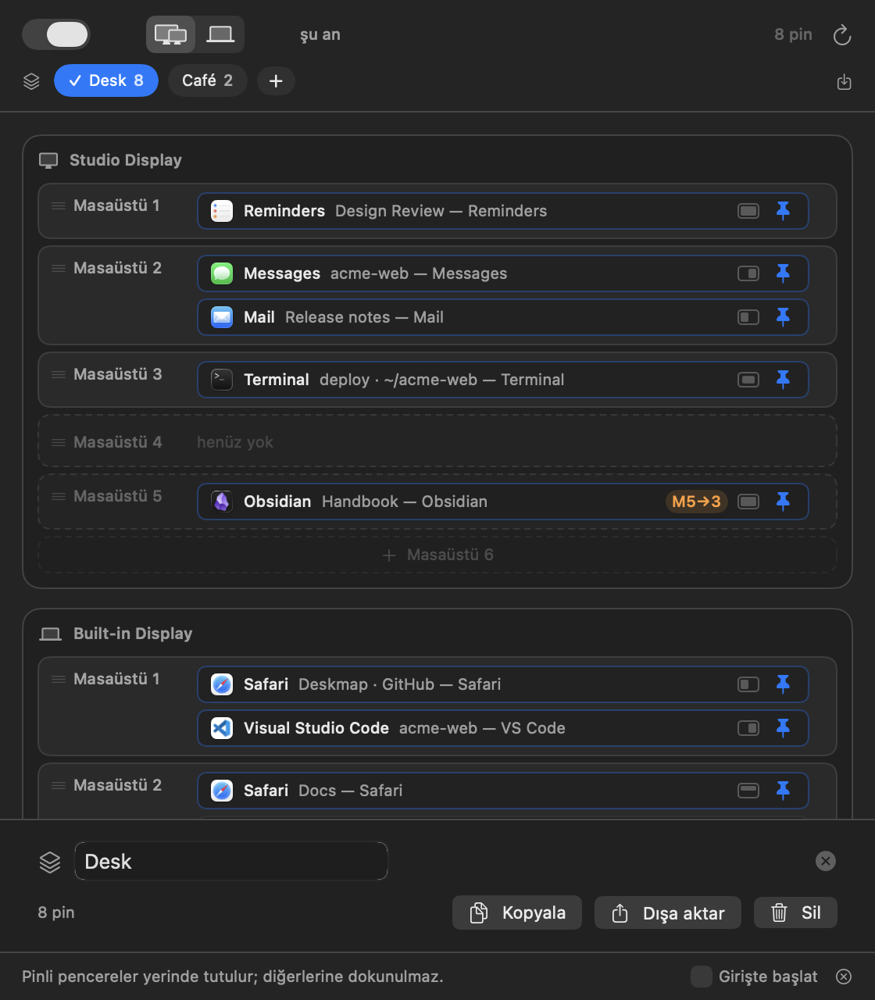

# Kullanım kılavuzu

Deskmap her pencereni doğru ekrana, doğru masaüstüne, doğru boyutta
koyar — ve sen bir daha söylemeden koymaya devam eder.

Bir kez söylüyorsun: *"başlığında `acme-web` geçen pencere, monitörde,
2. masaüstünde, sol yarıda durur."* Sonrası kendiliğinden: uygulamayı
açtığında, monitörü taktığında, öğle arasından döndüğünde.

Bu kılavuz on dakika sürer. macOS 13 ya da üstü gerekir.

---

## 1. Kur ve izni ver

1. **Deskmap.app**'i Uygulamalar klasörüne kopyala ve aç. Dock'ta simgesi
   yok; menü çubuğunda yaşar.
2. Menü çubuğundaki simgeye tıkla. İlk gördüğün **Erişilebilirlik izni
   gerekli** kartı olacak → **İzin ver**'e bas.
3. macOS, Sistem Ayarları › Gizlilik ve Güvenlik › Erişilebilirlik'i açar.
   **Deskmap**'ı aç.

   Bu izin pencere başlıklarını görmek ve pencereleri taşımak için gerekli.
   Başka bir şeye bakmaz: ağ yok, dosyalarına erişim yok, pencere içeriği yok.
4. Uygulamaya dön, alt çubuktaki **Girişte başlat**'ı aç ki her açılışta
   orada olsun.


## 2. Dört macOS ayarını düzelt (bir kez)

Uygulama bu ayarları canlı denetler ve düzelene kadar turuncu kartı kapatmaz.
Karttaki **Desktop & Dock'u aç** düğmesine bas ve şunları ayarla:

| Ayar | Olması gereken |
|---|---|
| Automatically rearrange Spaces based on most recent use | **Kapalı** |
| When switching to an application, switch to a Space with open windows | **Açık** |
| Displays have separate Spaces | **Açık** |
| Group windows by application | Kapalı (önerilir) |

Bir tane daha var, macOS hiçbir uygulamanın denetlemesine izin vermiyor:
pinleyeceğin her uygulamanın Dock simgesine sağ tık › **Options › Assign To →
None**. macOS uygulamayı kendi bir masaüstüne atadıysa pencere için
çekişirler.


## 3. İlk pinini koy

1. Önemsediğin pencereyi aç — diyelim VS Code'da bir proje.
2. Menü çubuğu simgesine tıkla. **Harita** her ekran için bir kart, her
   masaüstü için bir satır gösterir; satırlarda o an orada duran pencereler
   vardır.
3. Pencereni listede bul ve **pin** düğmesine bas. Altta bir panel açılır.


4. Panel pencerenin başlığını parçalara ayırır ve hangisinin bu pencereyi
   tanımladığını sorar. `acme-web — VS Code` için **acme-web**'i seç: proje
   adı; dosya adı değil, uygulama adı değil. Parçaların altında kaç açık
   pencerenin eşleştiği yazar — doğru parçayı seçtiğinin kontrolü.
5. **Pinle**'ye bas (ya da Return).

Pin bu demek: *bu uygulamanın başlığında `acme-web` geçen her penceresi
buraya aittir.* Yarınki pencere, haftaya açılan, yeniden başlattıktan
sonraki — hepsi aynı yere.

Aynı panelde iki çeşidi var:

- **Tüm pencereler** — başlığa bakmadan uygulamanın her penceresi. Mail,
  Slack gibi uygulamalar için iyi.
- **Sadece bu pencere** — pencereleri birbirinin aynı görünen uygulamalar
  için tek bir pencereyi pinler. Pencere kapanınca biter, kaydedilmez.

## 4. Ait olduğu yere taşı

Satırı (ya da çipi) başka bir masaüstü satırına sürükle — istediğin ekranda.
"Hayır, bu monitörde, 3. masaüstünde yaşar" demenin yolu bu.

- Henüz var olmayan masaüstleri kesik çizgiyle çizilir. Masaüstü oluşturmaya
  yalnızca **sen** izinlisin: Mission Control'ü aç, ekle; satır düz çizgiye
  döner.
- Turuncu **M5→3** rozeti, pin 5. masaüstünü istiyor ama ekranda 3 tane var
  demek; pencere sonuncuya gitti.
- **Pinsiz** bir pencereyi sürüklemek onu bir kez taşır, hiçbir şey kaydetmez.

## 5. Boyutunu ver

Pinli satıra ya da çipe tıkla ve bir düzen seç: **Tam**, **Sol yarı**, **Sağ
yarı**, **Sol %70** / **Sağ %30**, **Üst yarı**, **Alt yarı**, **Orta**.
Varsayılan "pencere şu an neredeyse orada"; kenarlardan bırakılacak boşluğu
da verebilirsin.


Düzen her pencereye bir kez uygulanır. Sonrasında istediğin gibi boyutlandır,
uygulama geri zıplatmaz. Her şeyin baştan yerleşmesini istersen **⌘R** (ya da
↻ düğmesi).

Elle boyutlandırıp beğendiğin bir ölçü mü var? Pinli satıra tıkla ve düzen
düzenleyicinin altındaki **Şu anki boyutu ve konumu kullan** düğmesine bas:
pencerenin şu anki yeri ve boyutu pinin düzeni olur. Pin ekranını ve
masaüstünü korur. Vazgeçersen ⌘Z ile geri al.

## 6. İki kurulum: monitörlü, monitörsüz

Takılı olmayan bir monitörün 3. masaüstünde pencere duramaz. Bu yüzden her
pinin iki hedefi var; üstteki düğmeler (**⌘1 / ⌘2**) aralarında geçiş yapar:

- **Monitör bağlı** — en az bir harici ekran takılı.
- **Sadece laptop** — yalnızca dahili ekran.

Birini kur, geç, diğerini kur. Monitörü taktığında ya da çıkardığında
uygulama ekranların yatışmasını birkaç saniye bekler, sonra o kurulumun
dediği yere her pinli pencereyi yerleştirir.

Bir pini kurulumlardan birinde istemiyorsan: alttaki kesik çizgili **tepsiye**
sürükle. Öteki kurulumda kalmaya devam eder.

## 7. Profiller: masa, kafe, sunum

Profil, adı olan bir pin takımı. Araç çubuğunun altındaki çipler anında
geçiş yapar.



- **+** boş profil açar; etkin profile tıklayınca adını değiştir, çoğalt, dışa
  aktar ya da sil.
- Dışa aktarma `.deskmap.json` dosyası yazar — kurulumunu başka Mac'e
  taşımanın ya da paylaşmanın yolu.

## 8. Fikrini değiştirdiğinde

- **Geri al**: pin kaldırdıktan, pin sürükledikten ya da masaüstü sırasını
  değiştirdikten sonra alt çubukta on saniye *"Pin kaldırıldı · Geri al"*
  durur. Tıkla ya da **⌘Z**. Uygulamada hiçbir yerde onay diyaloğu yok;
  sebebi bu.
- **Duraklat**: sol üstteki anahtar. Kapalıyken hiçbir pencere taşınmaz, menü
  çubuğu simgesi duraklat işaretine döner. Yeniden başlatmaya dayanır, yani
  uygulama uyuyor gibi görünüyorsa önce oraya bak.

## 9. Tek tuşla kurulum (isteğe bağlı)

Uygulama `deskmap://` bağlantılarını yanıtlar; URL açabilen her şey onu
sürebilir:

```sh
open "deskmap://profile/Kafe"   # profil değiştir
open "deskmap://reapply"        # her şeyi şimdi yerleştir
open "deskmap://toggle"         # duraklat / sürdür
```

Birini bir Shortcut'a koy, klavye kısayolu bağla; ya da macOS Focus
otomasyonuna: "Çalışma odağı açılınca Masa profiline geç".

## 10. Bir şey olmuyorsa

| Gördüğün | Anlamı |
|---|---|
| Pencere hiç kıpırdamıyor | Yönlendirme duraklatılmış (sol üst) ya da uygulama güncellemesinden sonra Erişilebilirlik izni düşmüş — yeniden ver. |
| Pencere yanlış masaüstüne gidiyor | "Automatically rearrange Spaces" açık kalmış ya da uygulamanın Dock **Assign To** ayarı **None** değil. |
| Pinin çipi soluk görünüyor | O pencereye daha özgül başka bir pin önce uyuyor. Üzerine gel, hangisi olduğunu söyler. |
| Turuncu **M5→3** rozeti | O masaüstü yok; Mission Control'den masaüstü ekle. |
| Masaüstleri arası taşıma olmuyor ama boyutlar çalışıyor | Bu macOS sürümü uygulamanın masaüstü taşıma için kullandığı özel çağrıları vermedi. Ekran ve düzen çalışmaya devam eder. |

Uzun sorun giderme, eşleştirmenin tam kuralları ve dosya biçimleri
[README](../README.md) içinde.

---

### Akılda kalacak iki cümle

**Pin, bir başlık sözüdür**: başlığında bu parça geçen her pencere, bundan
sonra buraya aittir. **Gerisi sürükle bırak** — harita zaten uygulamanın
kendisi.
