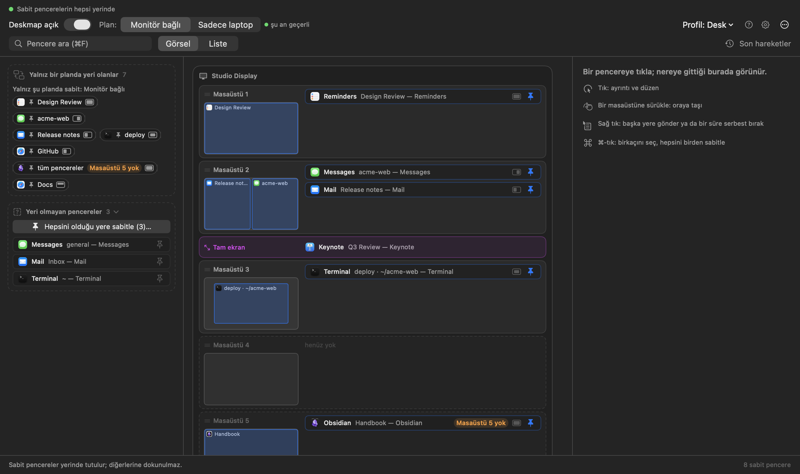
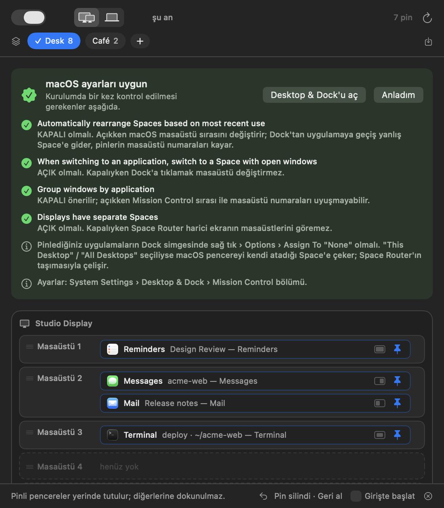
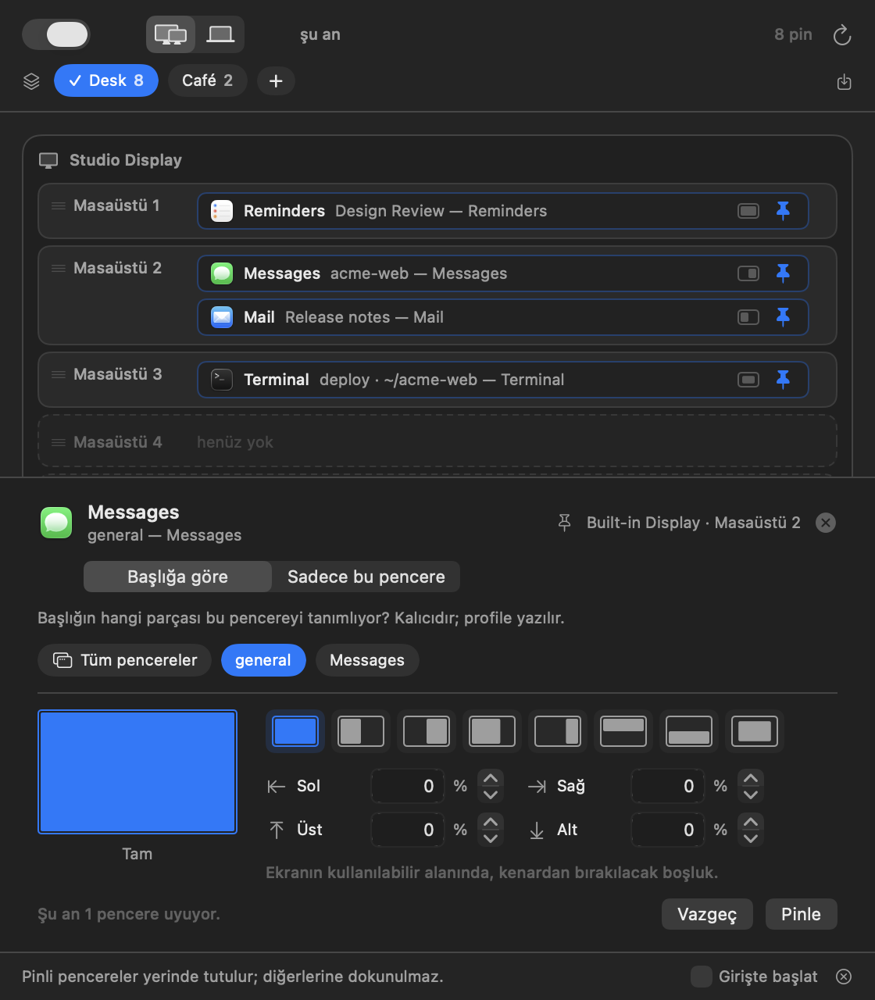
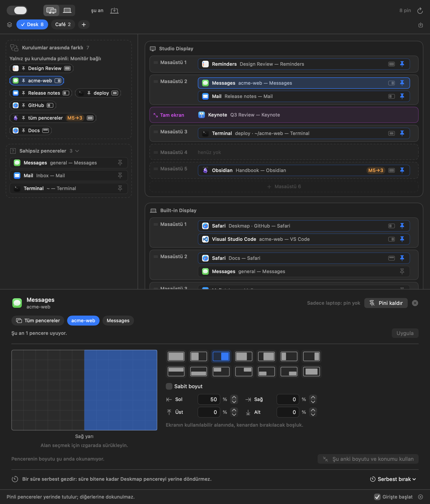
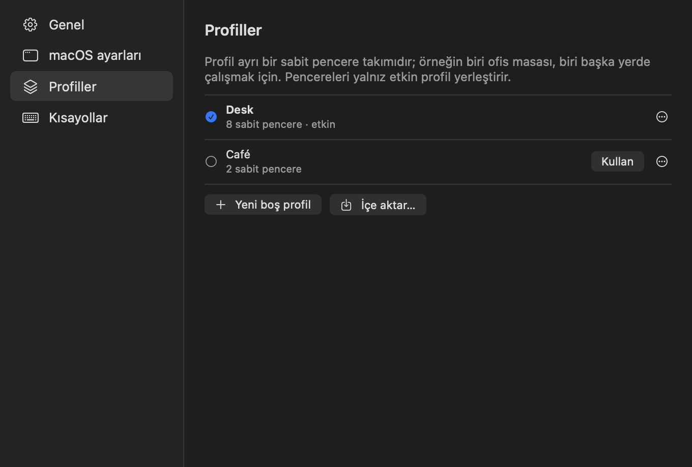

# Kullanım kılavuzu

Deskmap her pencereni doğru ekrana, doğru masaüstüne, doğru boyutta
koyar — ve sen bir daha söylemeden koymaya devam eder.

Bir kez söylüyorsun: *"başlığında `acme-web` geçen pencere, monitörde,
2. masaüstünde, sol yarıda durur."* Sonrası kendiliğinden: uygulamayı
açtığında, monitörü taktığında, öğle arasından döndüğünde.

Bu kılavuz on dakika sürer. macOS 13 ya da üstü gerekir.

---

## 1. Kur ve izni ver

1. **Deskmap.app**'i Uygulamalar klasörüne kopyala ve aç. Dock'ta simgesi
   yok; menü çubuğunda yaşar.
2. İlk açılışta **başlangıç rehberi** açılır ve üç adımda yürütür. 1. adım
   izin: **Sistem Ayarları'nı aç ve izin ver**'e bas.
3. macOS, Sistem Ayarları › Gizlilik ve Güvenlik › Erişilebilirlik'i açar.
   **Deskmap**'i aç; rehber kendiliğinden fark eder.

   Bu izin pencere başlıklarını görmek ve pencereleri taşımak için gerekli.
   Başka bir şeye bakmaz: ağ yok, dosyalarına erişim yok, pencere içeriği yok.
4. 2. adım aşağıdaki macOS ayarlarını denetler, 3. adım nasıl başlamak
   istediğini sorar: **Pencerelerimi olduğu yere sabitle** (önerilen) ya da
   **Boş başla**. Rehberi **Ayarlar › Genel**'den yeniden açabilirsin.
5. **Ayarlar**'ı aç (araç çubuğunda ⚙ ya da ⌘,) › **Genel** › **Girişte
   başlat**'ı aç ki her açılışta orada olsun.



## 2. Dört macOS ayarını düzelt (bir kez)

Uygulama bu ayarları canlı denetler: başlangıç rehberinin 2. adımı,
**Ayarlar › macOS ayarları** sekmesi ve sonradan biri bozulursa haritadaki
turuncu kart. **Desktop & Dock'u aç**'a bas ve şunları ayarla:

| Ayar | Olması gereken |
|---|---|
| Automatically rearrange Spaces based on most recent use | **Kapalı** |
| When switching to an application, switch to a Space with open windows | **Açık** |
| Displays have separate Spaces | **Açık** |
| Group windows by application | Kapalı (önerilir) |

Bir tane daha var, macOS hiçbir uygulamanın denetlemesine izin vermiyor:
sabitleyeceğin her uygulamanın Dock simgesine sağ tık › **Options › Assign To
→ None**. macOS uygulamayı kendi bir masaüstüne atadıysa pencere için
çekişirler.



## 3. İlk pencereni sabitle

1. Önemsediğin pencereyi aç — diyelim VS Code'da bir proje.
2. Menü çubuğu simgesine tıkla. **Harita** her ekran için bir kart, her
   masaüstü için bir satır gösterir; satırlarda o an orada duran pencereler
   vardır. Her masaüstünün yanında küçük bir **önizleme** pencereleri
   durdukları yerde çizer (**Görsel | Liste** ile kapatılır). Tek bir pencere
   mi arıyorsun? **⌘F**'ye bas, adının bir parçasını yaz.
3. Pencereni bul ve **raptiye** düğmesine bas (ya da satıra sağ tık ›
   **Bu masaüstüne sabitle…**). Ayrıntısı sağdaki sütunda açılır.



4. Panel tek bir cümleyle başlar, örneğin *Messages · bu pencere (general) →
   Built-in Display · Masaüstü 2 · Tam*. Altı çizili her parça bir menüdür.
   İlki iki seçenek sunar:
   - **Bu pencere (anahtar)** — Deskmap pencere için kararlı bir anahtar
     bulur ve parantez içinde gösterir. Sırayla: pencerenin gösterdiği dosya
     (Önizleme, Pages, Word, Excel, TextEdit… — iki ayrı `main.pdf`
     karışmaz); yoksa başlık değişirken hep aynı kalan parça (VS Code'un
     proje klasörü, Terminal'in `kullanıcı@makine`'si, Safari'nin sekme
     grubu); başlık değişimi henüz görülmediyse temizlenmiş başlık (sayfa
     numarası, "Düzenlendi", okunmamış sayısı atılır). Panel şu an kaç açık
     pencerenin eşleştiğini yazar.
   - **Uygulamanın bütün pencereleri** — başlığa bakmadan. Mail, Slack için iyi.

   Pencerenin kararlı anahtarı yoksa (başlığının her parçası değişiyor,
   örneğin sekme grubu olmayan Safari penceresi) ya da anahtar başka açık
   bir pencereye de uyuyorsa yalnız **bütün pencereler** sunulur.
5. **Sabitle**'ye bas (ya da ⌘Return).

Sabitleme bu demek: yarın aynı dosya ya da projeyle açılan pencere, yeniden
başlattıktan sonraki — hepsi aynı yere.

Birden çok pencere birden: *Yeri olmayan pencereler* kutusundaki **Hepsini
olduğu yere sabitle (…)…** (ya da satırlara ⌘-tık) onları seçer; sağdaki
sütunda onayla. Her biri şu anki masaüstünü, boyutunu ve konumunu korur.

## 4. Ait olduğu yere taşı

Satırı (ya da çipi) başka bir masaüstü satırına sürükle — istediğin ekranda.
"Hayır, bu monitörde, 3. masaüstünde yaşar" demenin yolu bu. Paneldeki
cümlede **Masaüstü 2**'ye ya da ekranın adına tıklayıp başkasını da
seçebilirsin; ya da satıra sağ tık › **Gönder**.

- Henüz var olmayan masaüstleri kesik çizgiyle çizilir. Masaüstü oluşturmaya
  yalnızca **sen** izinlisin: Mission Control'ü aç, ekle; satır düz çizgiye
  döner.
- Turuncu **Masaüstü 5 yok** rozeti, sabitleme 5. masaüstünü istiyor ama
  ekranda 3 tane var demek; pencere sonuncuda bekler (ayrıntı için üzerine
  gel).
- **Sabit olmayan** bir pencereyi sürüklemek onu bir kez taşır, hiçbir şey
  kaydetmez.

## 5. Boyutunu ver

Sabit bir satıra ya da çipe tıkla. Cümlenin altında dört düzen var: **Tam**,
**Sol yarı**, **Sağ yarı** ve **Olduğu gibi** (yalnız masaüstü korunur;
Deskmap pencereyi orada hiç taşımaz, boyutuna dokunmaz). Pencerenin başka bir
düzeni varsa beşinci döşeme **Özel** onu gösterir, tam adı satırın altında
yazar. Gerisi **Gelişmiş ▸**
altında: başlık parçaları, üzerinde sürükleyerek alan seçilen ızgara, bütün
hazır düzenler (%70/%30, üçte birler, çeyrekler, üst/alt yarı, orta),
kenarlardan bırakılacak boşluk ve sabit boyut. Gelişmiş'i bir kez açarsan
sonraki pencerede de açık kalır.



Düzen her pencereye bir kez uygulanır. Sonrasında istediğin gibi boyutlandır,
uygulama geri zıplatmaz. Her şeyin baştan yerleşmesini istersen **⌘R** (ya da
**⋯ › Sabit pencereleri şimdi yerine koy**).

Sabit bir pencereyi bir süre elle mi taşıyacaksın? Paneldeki **Serbest bırak**
ya da satıra sağ tık › **Serbest bırak** › 5, 15, 30… dakika. Süre bitene dek
Deskmap ona dokunmaz, sonra yerine koyar.

Elle boyutlandırıp beğendiğin bir ölçü mü var? Sabit satıra tıkla,
**Gelişmiş**'i aç ve **Şu anki boyutu ve konumu kullan**'a bas: pencerenin şu
anki yeri ve boyutu sabitlemenin düzeni olur. Ekran ve masaüstü değişmez.
Vazgeçersen ⌘Z ile geri al.

## 6. İki plan: monitörlü, monitörsüz

Takılı olmayan bir monitörün 3. masaüstünde pencere duramaz. Bu yüzden her
sabitlemenin iki hedefi var; üstteki **Plan** seçimi (**⌘1 / ⌘2**) birini ya
da ötekini gösterir. Şu an geçerli olan plan **şu an geçerli** diye
işaretlidir; öteki ne zaman geçerli olacağını yazar.

- **Monitör bağlı** — en az bir harici ekran takılı.
- **Sadece laptop** — yalnızca dahili ekran.

Birini kur, geç, diğerini kur. Monitörü taktığında ya da çıkardığında
uygulama ekranların yatışmasını birkaç saniye bekler, sonra o planın dediği
yere her sabit pencereyi yerleştirir.

Bir sabitlemeyi planlardan birinde istemiyorsan: sol kenar çubuğundaki
*Yalnız bir planda yeri olanlar* kutusuna sürükle. Öteki planda kalmaya
devam eder.

## 7. Profiller: masa, kafe, sunum

Profil, adı olan bir sabitleme takımı. Araç çubuğundaki **Profil: … ▾**
anında geçiş yapar.



- **Ayarlar › Profiller** hepsini listeler: **Kullan** geçer, **⋯** yeniden
  adlandırır, kopyalar, dışa aktarır ya da siler; altta **Yeni boş profil** ve
  **İçe aktar…**.
- Dışa aktarma `.deskmap.json` dosyası yazar — düzenini başka Mac'e
  taşımanın ya da paylaşmanın yolu.

## 8. Fikrini değiştirdiğinde

- **Geri al**: sabitlemeyi kaldırdıktan, sürükledikten ya da masaüstü
  sırasını değiştirdikten sonra alt çubukta on saniye *"Sabitleme silindi ·
  Geri al"* durur. Tıkla ya da **⌘Z**. Uygulamada hiçbir yerde onay diyaloğu
  yok; sebebi bu.
- **Son hareketler** (araç çubuğu): Deskmap hangi sabit pencereyi ne zaman
  nereye gönderdi — "pencerem neden zıpladı?" sorusunun cevabı.
- **Duraklat**: sol üstteki **Deskmap açık** anahtarı ya da menü çubuğu
  simgesine sağ tık › **15 dakika duraklat**. Kapalıyken hiçbir pencere
  taşınmaz, menü çubuğu simgesi duraklat işaretine döner. Kapatılan Deskmap
  yeniden başlatınca da kapalı kalır, yani uygulama uyuyor gibi görünüyorsa
  önce oraya bak.
- Araç çubuğundaki **?** haritadaki her rengi ve rozeti açıklar.

Menü çubuğu simgesine sağ tık öndeki pencere için **Olduğu yere sabitle**'yi,
sabit bir pencere için serbest bırakma sürelerini, profilleri, Ayarlar'ı ve
çıkışı da sunar. Sol tık haritayı açar.

## 9. Tek tuşla kurulum (isteğe bağlı)

Uygulama `deskmap://` bağlantılarını yanıtlar; URL açabilen her şey onu
sürebilir:

```sh
open "deskmap://profile/Kafe"   # profil değiştir
open "deskmap://reapply"        # her şeyi şimdi yerleştir
open "deskmap://toggle"         # duraklat / sürdür
```

Birini bir Shortcut'a koy, klavye kısayolu bağla; ya da macOS Focus
otomasyonuna: "Çalışma odağı açılınca Masa profiline geç".

## 10. Bir şey olmuyorsa

| Gördüğün | Anlamı |
|---|---|
| Pencere hiç kıpırdamıyor | Deskmap duraklatılmış (sol üst) ya da uygulama güncellemesinden sonra Erişilebilirlik izni düşmüş — yeniden ver. |
| Pencere yanlış masaüstüne gidiyor | "Automatically rearrange Spaces" açık kalmış ya da uygulamanın Dock **Assign To** ayarı **None** değil. |
| Sabitlemenin çipi soluk görünüyor | O pencereye daha özgül başka bir sabitleme önce uyuyor. Üzerine gel, hangisi olduğunu söyler. |
| Turuncu **Masaüstü 5 yok** rozeti | O masaüstü yok; Mission Control'den masaüstü ekle. |
| Bir pencere zıpladı, nedenini bilmiyorsun | Araç çubuğundaki **Son hareketler** her taşımayı ve hedefini listeler. |
| Masaüstleri arası taşıma olmuyor ama boyutlar çalışıyor | Bu macOS sürümü uygulamanın masaüstü taşıma için kullandığı özel çağrıları vermedi. Ekran ve düzen çalışmaya devam eder. |

Uzun sorun giderme, eşleştirmenin tam kuralları ve dosya biçimleri
[README](../README.md) içinde.

---

### Akılda kalacak iki cümle

**Sabitleme, bir başlık sözüdür**: başlığında bu parça geçen her pencere,
bundan sonra buraya aittir. **Gerisi sürükle bırak** — harita zaten
uygulamanın kendisi.
