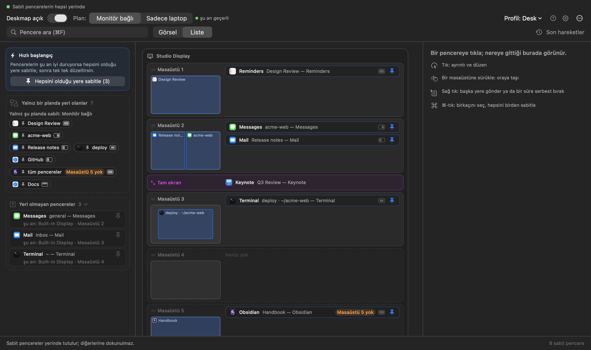

# Kullanım kılavuzu

Deskmap her pencereni doğru ekrana, doğru masaüstüne, doğru boyutta
koyar — ve sen bir daha söylemeden koymaya devam eder.

Bir kez söylüyorsun: *"başlığında `acme-web` geçen pencere, monitörde,
2. masaüstünde, sol yarıda durur."* Sonrası kendiliğinden: uygulamayı
açtığında, monitörü taktığında, öğle arasından döndüğünde.

Bu kılavuz on dakika sürer. macOS 13 ya da üstü gerekir.

---

## 1. Kur ve izni ver

1. **Deskmap.app**'i Uygulamalar klasörüne kopyala ve aç. Dock'ta simgesi
   yok; menü çubuğunda yaşar.
2. İlk açılışta **başlangıç rehberi** açılır ve üç adımda yürütür. 1. adım
   izin: **Sistem Ayarları'nı aç ve izin ver**'e bas.
3. macOS, Sistem Ayarları › Gizlilik ve Güvenlik › Erişilebilirlik'i açar.
   **Deskmap**'i aç; rehber kendiliğinden fark eder.

   Bu izin pencere başlıklarını görmek ve pencereleri taşımak için gerekli.
   Başka bir şeye bakmaz: ağ yok, dosyalarına erişim yok, pencere içeriği yok.
4. 2. adım aşağıdaki macOS ayarlarını denetler, 3. adım nasıl başlamak
   istediğini sorar: **Pencerelerimi olduğu yere sabitle** (önerilen) ya da
   **Boş başla**. Rehberi **Ayarlar › Genel**'den yeniden açabilirsin.
5. **Ayarlar**'ı aç (araç çubuğunda ⚙ ya da ⌘,) › **Genel** › **Girişte
   başlat**'ı aç ki her açılışta orada olsun.


## 2. Dört macOS ayarını düzelt (bir kez)

Uygulama bu ayarları canlı denetler: başlangıç rehberinin 2. adımı,
**Ayarlar › macOS ayarları** sekmesi ve sonradan biri bozulursa haritadaki
turuncu kart. **Masaüstü ve Dock'u aç**'a bas ve şunları ayarla (parantez
içinde İngilizce macOS'taki adı):

| Ayar | Olması gereken |
|---|---|
| Alanları en son kullanıma göre otomatik olarak yeniden düzenle (Automatically rearrange Spaces based on most recent use) | **Kapalı** |
| Bir uygulamaya geçildiğinde, uygulamanın açık pencerelerinin olduğu bir Alan'a geç (When switching to an application, switch to a Space with open windows) | **Açık** |
| Ekranların ayrı Alanları var (Displays have separate Spaces) | **Açık** |
| Pencereleri uygulamaya göre grupla (Group windows by application) | Kapalı (önerilir) |

Bir tane daha var, macOS hiçbir uygulamanın denetlemesine izin vermiyor:
sabitleyeceğin her uygulamanın Dock simgesine sağ tık › **Seçenekler › Ata →
Hiçbiri** (Options › Assign To → None). macOS uygulamayı kendi bir masaüstüne atadıysa pencere için
çekişirler.


## 3. İlk pencereni sabitle

1. Önemsediğin pencereyi aç — diyelim VS Code'da bir proje.
2. Menü çubuğu simgesine tıkla. **Harita** her ekranı, masaüstü başına bir
   küçük kartla gösterir. Kart minik bir ekrandır: o masaüstündeki her
   pencere kendi yerinde ve boyutunda bir kutudur. Kalabalıklaşan kart,
   aynı alanı kaplayan kutuları üst üste dizer ve her birinin başlığı
   görünür kalır; fazlasını **+3 daha** gibi bir düğmenin arkasına koyar.
   Kartın **≡** düğmesi düz listesini açar. Tek bir pencere mi arıyorsun?
   **⌘F**'ye bas, adının bir parçasını yaz.



   Satır mı istiyorsun? **Liste** (**Görsel**'in yanında) her masaüstü için
   bir satır ve yanında küçük bir önizleme gösterir.
3. Pencereni bul, kutusuna tıkla (ya da sağ tık › **Bu masaüstüne
   sabitle…**). Ayrıntısı sağdaki sütunda açılır. Henüz bir yere ait
   olmayan pencereler solda *Yeri olmayan pencereler* kutusunda bekler ve
   her biri *şu an* nerede olduğunu gösterir; oradan birine ya da
   **raptiye** düğmesine tıklayabilirsin.


4. Panel tek bir cümleyle başlar, örneğin *Messages · bu pencere (general) →
   Built-in Display · Masaüstü 2 · Tam*. Mavi her parça bir menü açan bağlantıdır.
   İlki iki seçenek sunar:
   - **Bu pencere (anahtar)** — Deskmap pencere için kararlı bir anahtar
     bulur ve parantez içinde gösterir. Sırayla: pencerenin gösterdiği dosya
     (Önizleme, Pages, Word, Excel, TextEdit… — iki ayrı `main.pdf`
     karışmaz); yoksa başlık değişirken hep aynı kalan parça (VS Code'un
     proje klasörü, Terminal'in `kullanıcı@makine`'si, Safari'nin sekme
     grubu); başlık değişimi henüz görülmediyse temizlenmiş başlık (sayfa
     numarası, "Düzenlendi", okunmamış sayısı atılır). Panel şu an kaç açık
     pencerenin eşleştiğini yazar.
   - **Uygulamanın bütün pencereleri** — başlığa bakmadan. Mail, Slack için iyi.

   Pencerenin kararlı anahtarı yoksa (başlığının her parçası değişiyor,
   örneğin sekme grubu olmayan Safari penceresi) ya da anahtar başka açık
   bir pencereye de uyuyorsa yalnız **bütün pencereler** sunulur.
5. **Sabitle**'ye bas (ya da ⌘Return).

Sabitleme bu demek: yarın aynı dosya ya da projeyle açılan pencere, yeniden
başlattıktan sonraki — hepsi aynı yere.

Cümlenin altındaki **Ekran** ve **Masaüstü** menüleri sabitlemeyi başka
yere taşır; en altta **Neden burada?** kutusu, pencereyi hangi sabitlemenin
oraya koyduğunu düz sözlerle söyler.

Birden çok pencere birden: solda yan sütunun en üstündeki **Hızlı başlangıç**
kartında **Hepsini olduğu yere sabitle (N)** var (ya da bazılarını seçmek
için kutulara ⌘-tık); sağdaki sütunda onayla. Her biri şu anki masaüstünü,
boyutunu ve konumunu korur.

## 4. Ait olduğu yere taşı

Pencerenin kutusunu (ya da çipini) başka bir masaüstünün kartına sürükle —
istediğin ekranda. "Hayır, bu monitörde, 3. masaüstünde yaşar" demenin yolu
bu. Paneldeki **Ekran** ve **Masaüstü** menülerini de kullanabilirsin; ya da
kutuya sağ tık › **Gönder**. Boş kartta *Boş · bir pencereyi buraya sürükle*
yazar; son kart **+ Masaüstü ekle** haritaya bir tane ekler.

- Henüz var olmayan masaüstleri kesik çizgiyle çizilir. Masaüstü oluşturmaya
  yalnızca **sen** izinlisin: Mission Control'ü aç, ekle; kart düz çizgiye
  döner.
- Karta sağ tıkla: **Masaüstünü yeniden adlandır…**, **Adı kaldır** ya da
  **Masaüstünü sil**. Hâlâ penceresi olan bir masaüstünü silmek önce sorar ve
  uygulamaları sıralar (macOS o pencereleri başka bir masaüstüne taşır).
- Şu an kapalı olan sabit pencereler, kartın minik ekranının altında çip
  olarak bekler. Kart başlığındaki **N aç** hepsini birden açar; her biri
  sabitlendiği yere gelir.
- Bir uygulama grubunun (ör. bir masaüstündeki bütün Excel pencereleri)
  başlığının sağında kendi düğmesi var: **↗** kapalı pinlerini açar, **✕**
  pinli pencerelerinin hepsini kapatır (uygulama açık kalır, sabit olmayan
  pencerelere dokunulmaz, kaydedilmemiş belge yine sorar). Her uygulamada
  çalışır.
- Turuncu **Masaüstü 5 yok** rozeti, sabitleme 5. masaüstünü istiyor ama
  ekranda 3 tane var demek; pencere sonuncuda bekler (ayrıntı için üzerine
  gel).
- **Sabit olmayan** bir pencereyi sürüklemek onu bir kez taşır, hiçbir şey
  kaydetmez.

## 5. Boyutunu ver

Sabit bir pencerenin kutusuna ya da çipine tıkla. Cümlenin altında dört düzen var: **Tam**,
**Sol yarı**, **Sağ yarı** ve **Olduğu gibi** (yalnız masaüstü korunur;
Deskmap pencereyi orada hiç taşımaz, boyutuna dokunmaz). Pencerenin başka bir
düzeni varsa beşinci döşeme **Özel** onu gösterir, tam adı satırın altında
yazar. Gerisi **Gelişmiş ▸**
altında: başlık parçaları, üzerinde sürükleyerek alan seçilen ızgara, bütün
hazır düzenler (%70/%30, üçte birler, çeyrekler, üst/alt yarı, orta),
kenarlardan bırakılacak boşluk ve sabit boyut. Gelişmiş'i bir kez açarsan
sonraki pencerede de açık kalır.


Düzen her pencereye bir kez uygulanır. Sonrasında istediğin gibi boyutlandır,
uygulama geri zıplatmaz. Her şeyin baştan yerleşmesini istersen **⌘R** (ya da
**⋯ › Sabit pencereleri şimdi yerine koy**).

Sabit bir pencereyi bir süre elle mi taşıyacaksın? Paneldeki **Serbest bırak**
ya da kutuya sağ tık › **Serbest bırak** › 5, 15, 30… dakika. Süre bitene dek
Deskmap ona dokunmaz, sonra yerine koyar.

Elle boyutlandırıp beğendiğin bir ölçü mü var? Sabit pencereye tıkla,
**Gelişmiş**'i aç ve **Şu anki boyutu ve konumu kullan**'a bas: pencerenin şu
anki yeri ve boyutu sabitlemenin düzeni olur. Ekran ve masaüstü değişmez.
Vazgeçersen ⌘Z ile geri al.

## 6. İki plan: monitörlü, monitörsüz

Takılı olmayan bir monitörün 3. masaüstünde pencere duramaz. Bu yüzden her
sabitlemenin iki hedefi var; üstteki **Plan** seçimi (**⌘1 / ⌘2**) birini ya
da ötekini gösterir. Şu an geçerli olan plan **şu an geçerli** diye
işaretlidir; öteki ne zaman geçerli olacağını yazar.

- **Monitör bağlı** — en az bir harici ekran takılı.
- **Sadece laptop** — yalnızca dahili ekran.

Birini kur, geç, diğerini kur. Monitörü taktığında ya da çıkardığında
uygulama ekranların yatışmasını birkaç saniye bekler, sonra o planın dediği
yere her sabit pencereyi yerleştirir.

Bir sabitlemeyi planlardan birinde istemiyorsan: sol kenar çubuğundaki
*Yalnız bir planda yeri olanlar* kutusuna sürükle. Öteki planda kalmaya
devam eder. Kutuda öteki plana ait görünen bir sabitlemeyi tamamen
kaldırmak için ona tıkla ve **… planındaki sabitlemeyi kaldır**ı seç.

## 7. Profiller: masa, kafe, sunum

Profil, adı olan bir sabitleme takımı. Araç çubuğundaki **Profil: … ▾**
anında geçiş yapar.


- **Ayarlar › Profiller** hepsini listeler: **Kullan** geçer, **⋯** yeniden
  adlandırır, çoğaltır, dışa aktarır ya da siler; altta **Yeni boş profil** ve
  **İçe aktar…**. Yeni ya da çoğaltılan profil kendiliğinden geçerli olmaz:
  **Kullan**'a bas.
- Masaüstü adları onları veren profile aittir: yeni profil adsız başlar, bir
  profilde masaüstünü yeniden adlandırmak öbürünü hiç değiştirmez.
  Bkz. [Masaüstü adları ve monitörün](#9-masaüstü-adları-ve-monitörün).
- Dışa aktarma `.deskmap.json` dosyası yazar — düzenini başka Mac'e
  taşımanın ya da paylaşmanın yolu.
- **Ayarlar › Yedekler**: Deskmap tüm profilleri, sabitlemeleri ve masaüstü
  adlarını kendiliğinden yedekler — son bir gün için saatte bir, son bir hafta
  için günde bir, haftada bir de süresiz. Birinde **Geri getir**'e, sonra
  **Şimdiki profillerin yerine koy**'a tıkla; şimdiki hâlin önce yedeklenir,
  haritanın alt çubuğunda *Geri al* çıkar (⌘Z). **Şimdi yedekle** hemen bir
  kopya alır.
- **⋯ › Sadece laptop planını buraya kopyala** (Monitör bağlı planı) etkin
  profilin laptop sabitlemelerini *ve* laptop masaüstlerinin sırasını (adlarıyla)
  Monitör bağlı planına kopyalar; o planda başka yerde duran aynı ad onunla
  birlikte taşınır. Pencereler buna uydurulur, ama hiçbir masaüstü silinmez.

## 8. Fikrini değiştirdiğinde

- **Geri al / Yinele**: her ayar değişikliği bir adımdır. **⌘Z** geri alır,
  **⇧⌘Z** yineler; alt çubukta ↶ ↷ düğmeleri de var. **Son hareketler ›
  Değişiklikler** bu oturumun adımlarını listeler; bir satırdaki **Buraya dön**
  ayarları o adımdan hemen sonraki hâline getirir (geri ya da ileri). Geri
  aldıktan sonra yeni değişiklik yapınca geri alınan adımlar silinir; alt
  çubuktaki uyarıdan *Geri al* onları geri getirir. Geçici pin değişiklikleri
  geri alınır ama yinelenemez. Geçmiş en fazla 50 adım tutar ve Deskmap
  kapanınca silinir. Neredeyse hiçbir şey onay istemez; sebebi
  bu. Tek istisna, hâlâ penceresi olan bir masaüstünü silmek.
- **Son hareketler › Pencere hareketleri** (araç çubuğu): Deskmap hangi sabit pencereyi ne zaman
  nereye gönderdi — "pencerem neden zıpladı?" sorusunun cevabı.
- **Duraklat**: sol üstteki **Deskmap açık** anahtarı ya da menü çubuğu
  simgesine sağ tık › **15 dakika duraklat**. Kapalıyken hiçbir pencere
  taşınmaz, menü çubuğu simgesi duraklat işaretine döner. O 15 dakika
  içinde anahtarı kendin açıp kapatırsan süre iptal olur. Kapatılan Deskmap
  yeniden başlatınca da kapalı kalır, yani uygulama uyuyor gibi görünüyorsa
  önce oraya bak.
- Araç çubuğundaki **?** haritadaki her rengi ve rozeti açıklar.

Menü çubuğu simgesine sağ tık öndeki pencere için **Olduğu yere sabitle**'yi,
sabit bir pencere için serbest bırakma sürelerini, profilleri, Ayarlar'ı ve
çıkışı da sunar. Sol tık haritayı açar.

## 9. Masaüstü adları ve monitörün

Bir ad, "monitörde 2. masaüstü"ne değil, tek bir gerçek masaüstüne aittir.
Masaüstünü taşı, Mission Control'de sırasını değiştir ya da laptop ekranına
götür: ad onunla gider, ada bağlı sabitlemeler de.

Her kurulumun — **Monitör bağlı** ve **Sadece laptop** — kendi *planı* var:
hangi ad hangi ekranda, hangi sırada ve her ekranda kaç masaüstü olmalı. Planı
sen yazmazsın; yaptıklarını izler: bir masaüstüne ad vermek, kartı sürüklemek,
Deskmap'te ya da Mission Control'de masaüstü sıralamak ya da eklemek içinde
bulunduğun kurulumun planını günceller.

Monitörü takınca ya da çıkarınca Deskmap yeni kurulumun planını uygular:

- **Adlı masaüstleri pencerelerini korur.** Her biri planlı yerine konur ve
  üzerindeki her şey, sabit olsun olmasın, onunla taşınır.
- **Adsız pencereler geri döner.** Monitördeki adsız bir masaüstünde duran
  pencereler laptopta kendi masaüstünde (eski masaüstü başına bir tane) bekler,
  monitörü yeniden takınca monitöre döner.
- **Yalnız boş artıklar silinir.** Bu geçişin boşalttığı ya da macOS'un yolda
  oluşturduğu masaüstleri, üzerinde hiçbir şey yoksa ve planın ötesindeyse
  silinir. Penceresi olan masaüstleri, adlı masaüstleri ve senin kendi boş
  masaüstlerin kalır.
- **Eksik masaüstleri oluşturulur**, plana kadar.
- **Silinmiş masaüstü satırı çıkmaz.** Ekran değişikliği yüzünden kaybolan
  masaüstü silme sayılmaz; satır yalnız *sen* Mission Control'de ya da
  Deskmap'te bir masaüstünü silince çıkar.

Bir pencere taşınamazsa olduğu yerde kalır, masaüstü korunur ve alt çubuk
bunu söyler.

**Ada sabitle.** Sabitleme paneli ve **Gönder** menüsü adları önce listeler.
Ada sabitlenen pencere o masaüstünü nereye giderse oraya kadar izler; adın
henüz masaüstü yoksa pencere bekler (harita *… bekleniyor* der) ve hiçbir şey
taşınmaz. Öbür kurulumda pencere için zaten bir yer yoksa, ada sabitleme iki
kurulum için de yapılır.

**Yükseltmeden sonraki ilk açılış.** Deskmap önce eski dosyanı yedekler
(`Backups/pre-migration/` içinde, asla silinmez). Sonra her adı, sabit
pencerelerinin gerçekten durduğu masaüstüyle eşleştirir ve ne yaptığını
anlatan bir **Masaüstü adları yükseltildi** kartı gösterir: yerleşen adlar,
henüz masaüstü bulamayan adlar, yanlışlıkla çıkmış silinmiş-masaüstü
satırlarının kaldırılması ve pinlerinin geri gelmesi. Bu adımda Deskmap hiçbir
pencere taşımaz, hiçbir masaüstü silmez. Planının ötesinde boş masaüstü
bulduysa kart **N boş masaüstünü kaldır** düğmesini sunar (her biri
silinmeden hemen önce yeniden boş mu diye bakılır). **Yükseltmeyi geri al** eski
dosyayı geri koyar (Deskmap yeniden açılana dek değişiklikler kaydedilmez); eski bir Deskmap yeni dosyayı yalnız okuma modunda açar.

## 10. Tek tuşla kurulum (isteğe bağlı)

Uygulama `deskmap://` bağlantılarını yanıtlar; URL açabilen her şey onu
sürebilir:

```sh
open "deskmap://profile/Kafe"   # profil değiştir
open "deskmap://reapply"        # her şeyi şimdi yerleştir
open "deskmap://toggle"         # duraklat / sürdür
```

Birini bir Shortcut'a koy, klavye kısayolu bağla; ya da macOS Focus
otomasyonuna: "Çalışma odağı açılınca Masa profiline geç".

## 11. Bir şey olmuyorsa

| Gördüğün | Anlamı |
|---|---|
| Pencere hiç kıpırdamıyor | Deskmap duraklatılmış (sol üst) ya da uygulama güncellemesinden sonra Erişilebilirlik izni düşmüş — yeniden ver. |
| Pencere yanlış masaüstüne gidiyor | "Alanları en son kullanıma göre otomatik olarak yeniden düzenle" (Automatically rearrange Spaces) açık kalmış ya da uygulamanın Dock **Ata** (Assign To) ayarı **Hiçbiri** (None) değil. |
| Sabitlemenin çipi soluk görünüyor | O pencereye daha özgül başka bir sabitleme önce uyuyor. Üzerine gel, hangisi olduğunu söyler. |
| Turuncu **Masaüstü 5 yok** rozeti | O masaüstü yok; Mission Control'den masaüstü ekle. |
| Bir pencere zıpladı, nedenini bilmiyorsun | Araç çubuğundaki **Son hareketler** her taşımayı ve hedefini listeler. |
| Masaüstleri arası taşıma olmuyor ama boyutlar çalışıyor | Bu macOS sürümü uygulamanın masaüstü taşıma için kullandığı özel çağrıları vermedi. Ekran ve düzen çalışmaya devam eder. |

Uzun sorun giderme, eşleştirmenin tam kuralları ve dosya biçimleri
[README](../README.md) içinde.

---

### Akılda kalacak iki cümle

**Sabitleme, bir başlık sözüdür**: başlığında bu parça geçen her pencere,
bundan sonra buraya aittir. **Gerisi sürükle bırak** — harita zaten
uygulamanın kendisi.
