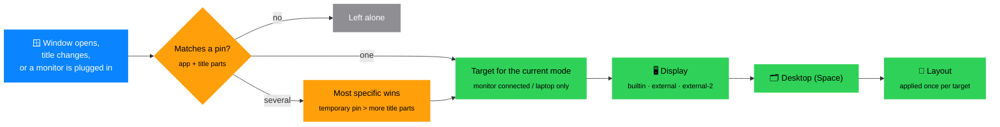
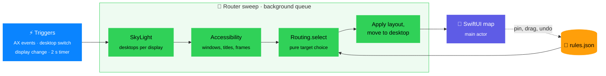

# Deskmap reference

Every rule, every setting, every failure mode. For the overview and the
comparison with other tools see the [README](../README.md); for a ten-minute
walkthrough see the [user guide](guide.md) ([Türkçe](kilavuz.md)).

- [Requirements](#requirements)
- [Install](#install)
- [Required macOS settings](#required-macos-settings)
- [Quick start](#quick-start)
- [How it works](#how-it-works)
- [Automation (URL scheme)](#automation-url-scheme)
- [Keyboard shortcuts](#keyboard-shortcuts)
- [Troubleshooting](#troubleshooting)
- [Architecture](#architecture)
- [Development](#development)
- [Limitations](#limitations)

## Requirements

- macOS 13 Ventura or later.
- To build: Xcode Command Line Tools (`xcode-select --install`) with Swift 5.9
  or later. Xcode itself is not required.
- To run the tests: a Swift 6 toolchain (Xcode 16 or its Command Line Tools),
  because the tests use Swift Testing.

## Install

```sh
git clone https://github.com/cnkndmr/Deskmap.git Deskmap
cd Deskmap
make app                      # release build → build/Deskmap.app
open build/Deskmap.app    # or: make run (builds and opens)
```

For a permanent install, copy the app to `/Applications` and turn on
**Launch at login** in the app's footer:

```sh
cp -R build/Deskmap.app /Applications/
```

**Launch at login** registers whichever copy is running. If you run it from
`build/`, the checkbox tooltip shows that path; move the app to
`/Applications` first if you want a stable login item. If macOS wants you to
confirm the login item, an orange **Approval needed** link appears next to
the checkbox and opens System Settings › General › Login Items.

### Coming from Space Router

Deskmap is the same app under a new name (see
[docs/naming.md](naming.md)). Your pins come with you: on first launch
`rules.json`, `rules.json.bak` and `session-pins.json` are copied from
`~/Library/Application Support/SpaceRouter/` into the new folder — copied, so
the old one stays where it is. `spacerouter://` URLs still work, and so do
`.spacerouter.json` profile exports.

Two things macOS ties to the old identity, so each needs doing once: grant the
**Accessibility** permission again, and switch **Launch at login** back on.

### Accessibility permission

Deskmap reads and moves other apps' windows through the Accessibility
API, so it needs permission once:

1. On first launch the window shows **Accessibility permission required**.
   Click **Grant Access**.
2. macOS shows its prompt and opens System Settings › Privacy & Security ›
   Accessibility. Turn on **Deskmap**.
3. The app checks the permission every 2 seconds and starts routing on its
   own. If it doesn't, quit it (✕ in the footer) and open it again.

The app is ad-hoc signed by default. macOS ties the permission to the code
signature, so **every rebuild needs the permission granted again**; see
[Troubleshooting](#accessibility-stops-working-after-a-rebuild).

Only one copy runs at a time: if a second Deskmap starts (for example a
`build/` copy while the `/Applications` copy is running), it quits right
away, so two routers never fight over the same windows.

### Language

The interface is in English and has a Turkish translation. The app uses the
first language in your preferred-language list (System Settings › General ›
Language & Region) that it supports, so Turkish appears only when Turkish is
listed before English (or English isn't listed at all). To force a language
for Deskmap alone:

```sh
defaults write com.deskmap.app AppleLanguages -array en   # or: tr
defaults delete com.deskmap.app AppleLanguages            # back to the system order
```

Quit and reopen the app after changing it.

## Required macOS settings


Deskmap checks these settings live and shows an orange **macOS settings
need fixing** card until they are right. The card has an **Open Desktop &
Dock** button.

**System Settings › Desktop & Dock › Mission Control:**

| Setting | Must be | Why |
|---|---|---|
| Automatically rearrange Spaces based on most recent use | **Off** | When on, macOS reorders your desktops: switching to an app from the Dock lands on a neighbouring Space, the window flashes and disappears, and pins end up on the wrong desktop numbers. |
| When switching to an application, switch to a Space with open windows | **On** | When off, clicking an app in the Dock does not switch desktops. |
| Group windows by application | Off (recommended) | When on, the Mission Control order may not match desktop numbers. |
| Displays have separate Spaces | **On** | When off, Deskmap cannot see the external display's desktops. |

**Dock icon › right-click › Options › Assign To → None** for every app you
pin. With "This Desktop" or "All Desktops", macOS pulls the window to the
Space it assigned, which conflicts with Deskmap's moves. This one cannot
be checked automatically; the card reminds you, and **Got It** hides the
reminder (the card comes back if one of the live-checked settings changes).

<br clear="right">

## Quick start

1. Click the menu bar icon. The window shows a **map**: one card per display,
   one row per desktop, with the windows currently on each desktop.
2. On a window row, click the **pin** button. A panel opens at the bottom.
3. Choose which part of the title identifies the window, for example the
   project name rather than the file name. The panel shows how many open
   windows match right now. Pick a layout if you want one (the default is
   the window's current position and size).
4. Click **Pin** (or press Return). From now on, every window of that app
   whose title contains that part goes to this desktop, in this layout.
5. To pin the window to a different desktop, drag its row or chip onto
   another desktop row on the map.
6. Switch the mode selector at the top (laptop / monitor, ⌘1 / ⌘2) and repeat
   for the other setup. The two setups are independent.

A **Getting Started** card with these steps is shown while the active profile
has no pins.

## How it works



### Pins (rules)


A pin says: *windows of this app whose title contains these parts go to this
display, this desktop, in this layout*.

- **App**: matched by bundle identifier (or by app name for old rules without
  one).
- **Title parts**: the title is split at common separators (` — `, ` – `,
  ` | `, ` · `, ` • `, and ` - ` / ` : ` with spaces around them; a leading
  "unsaved" dot is ignored). A window matches when its title contains **all**
  selected parts, ignoring case. By default the last part that isn't the app
  name is selected, because the workspace name is usually at the end.
- **All windows**: pins every window of the app, regardless of title (also
  used automatically for windows without a title).
- **More specific wins**: when several pins match a window, the one with more
  title parts is used. A pin that matches an open window but loses to a more
  specific pin (or to a temporary pin) is shown as a faded chip; its tooltip
  says which pin matches first.
- If you pin with the same app and the same parts as an existing pin, the
  existing pin is updated instead of creating a second one.

What Deskmap enforces:

- **Desktop**: a pinned window is kept on its desktop. If it ends up
  elsewhere, it is moved back.
- **Layout**: applied once per window and target. After that you can resize
  the window freely; the layout is applied again when you press ⌘R (↻), when
  pins change, or after a display change. Windows on a desktop you are not
  looking at get their layout when you switch to that desktop.
- **Use current size and position**: after resizing or moving a pinned window
  by hand, click its row and press this button under the layout editor. The
  window's current position and size (relative to its display's usable area)
  replace the pin's saved layout; for a fixed-size pin, the size in points and
  the anchor from the edges the window touches (a window touching no edge
  keeps the saved anchor). Only the layout changes: the pin keeps its
  display and desktop, and no new pin is written. Works for temporary pins too.
- Windows of full-screen apps are never touched. Windows without a pin are
  never moved by the engine.

Click a pinned row or a chip to open its panel: change the layout, **Unpin**,
or change the title parts (this needs a window matching the pin to be open;
**Apply** refuses a selection that would duplicate another pin's app and
parts).

<br clear="right">

### Temporary pins

In the pin panel, **This window only** pins one specific window instead of a
title. Use it for apps whose windows all have the same title. A temporary pin
follows the window's ID: it ends when the window closes or its app restarts,
and it is not saved to the profile. It survives a Deskmap restart as long
as the window is still open. Temporary pins have an orange icon and take
precedence over normal pins.

### Two modes: monitor connected / laptop only

Each pin has a separate target for each mode:

- **Monitor connected**: at least one external display is attached.
- **Laptop only**: only the built-in display.

The mode selector shows the current mode ("now") by default; you can switch it
to edit the other setup. Live windows are listed on the map only for the
current mode; the other mode shows its pins as chips. The sidebar's
*Unassigned windows* box is the same in both tabs (open windows are the same
in both setups): on the other setup's tab, dropping one on a desktop (or
pressing its pin) opens a pin for that setup and does not move the window. When a monitor is plugged in or
unplugged, Deskmap waits for the displays to settle (2.5 s, at most
10 s) and then places every pinned window again.

Displays are identified by role, not by serial number: `builtin`, `external`,
`external-2`, … External displays are numbered left to right; displays stacked
in the same column are ordered by vertical position (the lower one first),
then by UUID. A pin whose display isn't connected is skipped.

### Desktops

- **Missing desktops**: if a pin targets desktop 5 but the display has only
  3, the window goes to the last one and the row shows an orange **D5→3**
  badge (**M5→3** in Turkish). Rows for desktops that don't exist yet are
  drawn dashed. The **+ Desktop N** row at the bottom of each display adds a
  real desktop: Mission Control opens for a moment and Deskmap presses its
  **+** button. In the setup that is not active the desktop is planned and
  created when that setup becomes active. Right-click a desktop row to
  remove it.
- **Reordering**: drag a desktop's label ("Desktop 2") up or down. All pins
  on that display in this mode (and temporary pins) are renumbered to match,
  and the windows are moved.
- **Unpinned windows**: dragging an unpinned row to another desktop moves the
  window once; nothing is saved. Windows of full-screen apps are never moved
  and are not listed as unassigned.
- **Sidebar**: *Different between setups* lists pins with no target in this
  mode, pins with a target only in this mode, and pins sent to another
  display or desktop in the other mode. Dropping a pinned row or chip from
  the map there removes its target for this mode (a pin with no target in
  either mode is deleted); dropping a chip back into the box does nothing.
  *Unassigned windows* lists open windows with no pin in either mode; the
  menu bar icon shows their number.

### Profiles


A profile is a named set of pins; the chips under the toolbar list them with
their pin count.

- Click a profile to switch to it. Windows are placed again right away.
- Click the active profile to rename, **Duplicate**, **Export** or **Delete**
  it (the last profile cannot be deleted).
- **+** creates an empty profile. The import button reads a
  `.deskmap.json` file exported earlier; a plain `rules.json` also works.
- Profiles can be switched from Shortcuts, Raycast and others via the
  [URL scheme](#automation-url-scheme).

<br clear="right">

### Undo

There are no confirmation dialogs. After these actions the footer shows
"*action* · Undo" for 10 seconds; click it or press ⌘Z:

- unpinning (**Pin removed**), dragging a pin to another desktop (**Pin
  moved**), re-pinning over an existing target (**Pin updated**), saving the
  window's current size as the layout (**Layout saved**), editing title
  parts, reordering desktops, deleting a profile, dragging a temporary pin.

Undo is one level deep and restores only that action. Any other change in
between (a new pin, a layout step, a profile switch, a URL command) cancels
the pending undo so it can't wipe that change. Not undoable: adding a pin,
layout edits, adding, renaming, importing or switching profiles, and adding or
removing temporary pins. While the cursor is in a text field, ⌘Z undoes the
text edit.

### Pausing

The switch at the top left pauses routing (the menu bar icon changes to a
pause symbol). Windows are still listed, but nothing is moved. Pausing is
saved and survives restarts.

### Where data lives

| File | Contents |
|---|---|
| `~/Library/Application Support/Deskmap/rules.json` | Pins, profiles, known displays, the on/off switch. Written 0.4 s after a change and on quit. |
| `~/Library/Application Support/Deskmap/rules.json.bak` | Copy of an unreadable or partly unreadable `rules.json`, made before it is overwritten. |
| `~/Library/Application Support/Deskmap/session-pins.json` | Temporary pins (window ID + process ID). |
| `<name>.deskmap.json` | An exported profile. |

See [docs/architecture.md](architecture.md#data-files) for the formats.

## Automation (URL scheme)

Deskmap handles `deskmap://` URLs, so Shortcuts, Raycast,
Hammerspoon, Keyboard Maestro or a terminal can control it. If the app isn't
running, macOS starts it first.

| URL | Effect |
|---|---|
| `deskmap://reapply` | Place pinned windows now (same as ↻ / ⌘R) |
| `deskmap://pause` | Pause routing |
| `deskmap://resume` | Resume routing |
| `deskmap://toggle` | Pause / resume |
| `deskmap://profile/<name>` | Switch to the named profile (exact match first, then case-insensitive) |
| `deskmap://profile?name=<name>` | Same; use this for names containing `/` |
| `deskmap://next-profile` | Switch to the next profile, wrapping around (`next` and `nextprofile` also work) |
| `deskmap://add-desktop/<screen>` | Add a desktop to a connected display (`builtin`, `external`, …); opens Mission Control briefly and presses its **+** |
| `deskmap://remove-desktop/<screen>/<n>` | Remove desktop *n* of a connected display through Mission Control; pins shift like the map does |
| `deskmap://reload` | Re-read `rules.json` from disk |
| `deskmap://status` | Write `status.json` now |
| `deskmap://pin/<window>/<screen>/<n>` | Temporary pin: keep window id *window* on desktop *n* of *screen* until it closes |
| `deskmap://unpin/<window>` | Remove the temporary pin |
| `deskmap://move/<window>/<screen>/<n>` | Move the window once |
| `deskmap://rule-add?json=<rule>` | Add a rule (percent-encoded rule JSON, same shape as in `rules.json`) |
| `deskmap://rule-remove/<id>` | Remove a rule |
| `deskmap://profile-rename/<name>?name=<new>` | Rename a profile |
| `deskmap://profile-export?path=<absolute path>[&name=<profile>]` | Export a profile (default: active) as `.deskmap.json` |
| `deskmap://desktop-move/<screen>/<n>/<m>[?mode=docked\|undocked]` | Move desktop *n* to position *m*, like dragging its label: pins follow; in the live mode windows move too |
| `deskmap://rule-save-layout/<rule id>[?window=<id>]` | Use a matching window's current size and position as the rule's layout (live mode) |
| `deskmap://profile-set?json=<profile>&activate=1` | Create or update a profile by name |
| `deskmap://plan-desktops/<screen>/<count>[?mode=]` | Make a display have *count* desktops |

Any command accepts `?req=<id>`: after handling it Deskmap writes
`status.json` with `"request": "<id>"`, so a script can wait for the command
and read `lastError`.

Command names are case-insensitive, and `deskmap:reapply` (without `//`)
works too. Spaces and non-ASCII characters must be percent-encoded:
`Office Desk` → `deskmap://profile/Office%20Desk`. An unknown command or
profile shows a red error in the app's footer; there is no other
notification.

```sh
open "deskmap://profile/Office"
open "deskmap://reapply"
```

### Command line (`deskmap`)

`scripts/deskmap` wraps the URLs and `status.json` (link it into your `PATH`).
It waits for each command and exits non-zero with Deskmap's error message.

```sh
deskmap status                      # mode, profile, screens, counts
deskmap windows --app Code          # id, app, screen/desktop, title
deskmap move Safari external 2      # window id or a unique app/title fragment
deskmap pin 12345 builtin 1 && deskmap unpin 12345
deskmap rule add --app cmux --screen external --undocked-screen builtin --layout 0,0,0.5,1
deskmap rule rm <id>
deskmap pause | resume | reload | profile Office
deskmap profile-rename Office "Office desk"
deskmap export ~/office.deskmap.json [--profile Office]
deskmap desktop-move external 1 3          # desktop 1 becomes desktop 3
deskmap save-layout Safari [--window 12345] # keep the size you just dragged
```

### Layout files (`deskmap apply`)

Describe a setup in one file and let Deskmap build it
(see [`examples/layout.yaml`](examples/layout.yaml)). By default the
**active profile** is edited: rules for the windows in the file are added or
updated (same app + title fragments keeps the rule's id), every other rule
stays. Add `profile: <name>` to edit or create another profile (`apply`
switches to it), and `replace: true` to make the file the profile's whole rule
list.

```yaml
desktops:
  docked:   {external: 3, builtin: 2}
  undocked: {builtin: 4}
windows:
  - app: Code
    title: Orion        # title fragment(s), optional
    docked: external/1 left-half   # screen/desktop layout
    undocked: builtin/1 full
  - app: cmux
    docked: {screen: external, desktop: 2, layout: center-two-thirds}
    launch: true                   # open it if no window is open
  - app: Microsoft Teams
    place: builtin/2 center        # same in both modes
```

```sh
deskmap apply desk.yaml --dry-run  # what would change (rules, desktops, launches)
deskmap apply desk.yaml            # edit the active profile (or the named one), report
deskmap check desk.yaml            # is everything where the file says? (no changes)
deskmap apply --undo               # back to the previous profile and rules
deskmap layouts                    # layout names: left-half, top-right, center-third…
```

The report lists every open window the file's rules pick (same choice as
Deskmap: temporary pin first, then the rule with the most title fragments)
and marks it ✓ or ✗ with the reason (wrong desktop, size off, full screen).
`apply` exits 2 when something is not in place. Only one profile is written;
other profiles are never touched. `--undo` does not revert desktop
counts. `launch` may be `true`, a file/folder path to open with the app, or a
shell command. YAML needs PyYAML; `.json` files work without it.

`status.json` (next to `rules.json`) holds the live state: screens, windows
with their placement and temporary pin, rules, active profile, whether
routing is paused, and the last error.

### Screen change hooks (`hooks.json`)

When a window ends up on another display, Deskmap runs matching commands
from `hooks.json` (next to `rules.json`, re-read when it changes):

```json
[{"app": "cmux", "from": "*", "to": "builtin", "run": "~/bin/cmux-layout grid"}]
```

`app` is a bundle id or app name, `from`/`to` a screen role (`builtin`,
`external`, …) or display name; `*` or a missing field matches anything.
The command runs through `/bin/sh -c` in the background (stopped after
30 s) with `DESKMAP_APP`, `DESKMAP_BUNDLE_ID`, `DESKMAP_PID`,
`DESKMAP_WINDOW_ID`, `DESKMAP_FROM`, `DESKMAP_TO` (and `_NAME` variants)
and `DESKMAP_CAUSE`: `move` (dragged or moved by a rule) or `display` (a
display was connected or removed and macOS moved the window). While the
mouse button is down the hook waits; dropping the window back where it
started runs nothing. `scripts/hooktest/run.sh` tests this end to end with a
virtual display.

- **Shortcuts**: add an **Open URLs** action with `deskmap://profile/Home`,
  then attach a keyboard shortcut or a Focus automation.
- **Raycast**: create a **Quicklink** such as `deskmap://toggle`.
- **Hammerspoon**:

  ```lua
  hs.hotkey.bind({"cmd", "alt"}, "1", function()
    hs.urlevent.openURL("deskmap://profile/Office")
  end)
  ```

## Keyboard shortcuts

These work while the Deskmap window is open and focused.

| Keys | Action |
|---|---|
| ⌘R | Place pinned windows now |
| ⌘1 / ⌘2 | Show the *Monitor connected* / *Laptop only* setup |
| ⌘Z | Undo the last action (while the "· Undo" link is visible) |
| Return | Confirm the pin panel (**Pin**) |
| Esc | Close the open panel at the bottom |

## Troubleshooting

### Accessibility stops working after a rebuild

Symptoms: the permission card keeps coming back, or Deskmap looks enabled
in System Settings but nothing moves. Each build is ad-hoc signed with a new
signature, and macOS keeps the permission for the old one.

1. Quit Deskmap.
2. In System Settings › Privacy & Security › Accessibility, select
   **Deskmap** and remove it with **−** (turning it off and on again is
   often not enough). Alternatively, from a terminal:
   `tccutil reset Accessibility com.deskmap.app`.
3. Open the new build and grant the permission again.

Signing with a stable identity (`SIGN_IDENTITY=... make app`, see
[Distribution](#distribution)) avoids this.

### Windows land on the wrong desktop or flash and disappear

Check the macOS settings card: "Automatically rearrange Spaces based on most
recent use" must be off, and the app's Dock **Assign To** must be **None**.
See [Required macOS settings](#required-macos-settings).

### A pin doesn't take effect

- Faded chip: another, more specific pin (or a temporary pin) matches the
  window first; hover over the chip to see which one.
- The pin's display isn't connected in the current mode, or the pin has no
  target in this mode (it's in the sidebar under *Different between setups*).
- **D5→3** badge: the target desktop doesn't exist; add desktops in Mission
  Control.
- The window belongs to a full-screen app.
- Routing is paused (switch at the top left, pause icon in the menu bar).

### "Moving windows between desktops is not available on this macOS"

The private SkyLight functions for moving windows between Spaces were not
found on this macOS version. Windows are still placed on the right display and
in the right layout, but not moved between desktops.

### "*App* not responding; skipped for now"

An app did not answer Accessibility requests (it is frozen or stopped in a
debugger). Deskmap skips it for 2 s, doubling up to 30 s, so one app
can't stall the others. It is picked up again automatically once it responds.

### Errors about rules.json

- "*N* rules could not be read": broken entries were skipped; the original
  file was saved as `rules.json.bak` first.
- "rules.json belongs to a newer version of Deskmap": a newer version
  wrote this file. The older version reads it but won't overwrite it; changes
  are not saved.

### External display roles swapped

If two external displays share the same left edge, their roles (`external`,
`external-2`) are ordered by vertical position (the lower display first).
After an update that changed this order, drag the affected pins once; the
order stays the same afterwards.

### Reading the log

The engine logs sparingly (moves, give-ups, unresponsive apps, display
changes, sleep/wake) to the unified log. Window titles are redacted.

```sh
log stream --predicate 'subsystem == "com.deskmap.app"' --level info
```

Categories: `routing`, `skylight`, `ax`, `screens`. At launch the `skylight`
category reports whether SkyLight is available and which desktop move method
this macOS uses.

## Architecture

```
app/Sources/Deskmap/
├── DeskmapApp.swift      App entry: MenuBarExtra, AppModel, URL delegate, single instance
├── Localization.swift        L(): English keys, Turkish table in app/Resources/tr.lproj
├── Models/
│   ├── Rule.swift            Rule (pin), Destination, WindowLayout, Mode, title splitting
│   ├── Store.swift           Document (rules.json, pure operations), Profile, Store (publishes, saves)
│   └── UndoBuffer.swift      One-level undo
├── Services/
│   ├── Router.swift          The engine: sweeps, moves, layouts, temporary pins
│   ├── Routing.swift         Pure target selection and retry accounting
│   ├── Accessibility.swift   Window list, titles, frames (AX API), unresponsive-app backoff
│   ├── SkyLight.swift        Reading and moving Spaces (private SkyLight calls)
│   ├── ScreenService.swift   Connected displays, roles, settle delay
│   ├── WindowEvents.swift    AX observers and workspace notifications that trigger sweeps
│   ├── URLCommands.swift     deskmap:// parsing and execution
│   ├── MacSettings.swift     Live check of the required macOS settings
│   └── Log.swift             os.Logger categories
└── Views/                    Map, window rows, chips, pin/profile panels, status cards
```



The **Router** sweeps every 2 seconds and right after window events (new
window, title change, focus change, desktop switch). A sweep runs on a
background queue: it reads the displays' desktops (SkyLight), the window
server list and each app's windows (Accessibility), picks each window's
target with `Routing.select` (the same function the UI uses), then applies the
layout and moves the window to its desktop. The results go back to the main
actor, where SwiftUI shows them.

There is no public API for moving a window to another Space.
`SkyLight.swift` resolves the private calls also used by Hammerspoon and
yabai at runtime with `dlsym` (`SLSMoveWindowsToManagedSpace`,
`SLSSpaceSetCompatID` + `SLSSetWindowListWorkspace`, and
`SLSBridgedMoveWindowsToManagedSpaceOperation` on macOS 26.4+) and picks the
one that fits the macOS version. If a symbol is missing, the app doesn't
crash: it skips the desktop move and still places the window on the right
display and in the right layout.

More detail (sweep steps, retry limits, data formats, localization):
[docs/architecture.md](architecture.md).

## Development

```sh
make check              # debug build
make test               # unit tests (Swift Testing)
make concurrency-check  # build with -strict-concurrency=complete and list warnings (report only)
make app                # release build + .app bundle in build/
make run                # make app, then open it
make dist               # distributable package (see below)
make clean              # delete build/ and app/.build/
```

The tests (`app/Tests/DeskmapTests`, 122 tests in 10 suites) cover pure
logic only: rule matching (including Turkish İ/ı case rules) and title
splitting, layouts and coordinates, `rules.json` schema migrations, document
operations on pins and profiles, import/export, target selection, retry and
backoff helpers, undo validity, map logic, and localization consistency.
They never touch the disk or real windows.

Enable the pre-commit hook to build and test before every commit that
touches Swift files:

```sh
git config core.hooksPath .githooks
```

CI (`.github/workflows/ci.yml`) builds, tests and packages the app on every
push to `main` and on pull requests. The version number comes from the
`VERSION` file.

`scripts/build-and-run.command` (double-click in Finder) quits the running
Deskmap, builds and opens the new copy, and writes the output to
`build/last-build.log`.

### Localization

User-facing text goes through `L("English text")` or
`L("Format %@ with %ld", value, count)`. The English string is the key; the
Turkish translation lives in `app/Resources/tr.lproj/Localizable.strings`.
`LocalizationTests` fails if a key has no Turkish entry, if a Turkish entry is
unused, or if format specifiers don't match. See
[docs/architecture.md](architecture.md#localization).

### Distribution

`make dist` builds a universal (arm64 + x86_64) `Deskmap.app` and packs it
as `build/dist/Deskmap-<version>.zip` (`FORMAT=dmg` or `FORMAT=both` for
a DMG; `VERSION=0.3.1` overrides the version). The default signature is
ad-hoc: recipients must open the app the first time with **right-click ›
Open**, or run `xattr -dr com.apple.quarantine /Applications/Deskmap.app`.
To distribute without Gatekeeper warnings, use a Developer ID and notarize:

```sh
xcrun notarytool store-credentials notary --apple-id ... --team-id ... --password <app-specific>
SIGN_IDENTITY="Developer ID Application: Name (TEAMID)" NOTARY_PROFILE=notary make dist
```

`scripts/make-dist.command` runs `make dist` from Finder.

## Limitations

- **Private APIs.** Moving windows between Spaces and finding windows on
  other desktops rely on private SkyLight and Accessibility functions. A macOS
  update can break them. Every desktop move is checked on the next scan; if
  moves keep having no effect, Deskmap switches to a reduced mode (display and
  layout only, desktop moves off) and shows a card with a **Try Again** button.
- **Unknown state means hands off.** If macOS doesn't say which desktop a
  window is on, the window is only listed: it is neither moved nor resized.
- **Desktops are added through Mission Control.** macOS has no public way
  to create a desktop, so Deskmap opens Mission Control briefly and presses
  its **+** button. Pins beyond the last desktop go to the last one.
- **Titles must identify the window.** Apps that don't show a workspace or
  document name in the title can only be pinned app-wide or with temporary
  pins.
- **Full-screen windows** are left alone.
- **Two setups only**: monitor connected / laptop only. External displays are
  identified by position (left to right), not by model or serial number.
- **Not instant.** Placement happens on window events. A light check every
  5 seconds catches what events miss (a full scan only when something
  changed, plus one every two minutes); title changes are grouped for a
  second and only count for apps with title-based pins. Apps
  that resize slowly get a few retries.
- **One-level undo**, visible for 10 seconds.
- **Ad-hoc signing** by default, so the Accessibility permission must be
  granted again after each rebuild.
- **Languages**: English and Turkish.

## License

MIT; see [LICENSE](../LICENSE).
