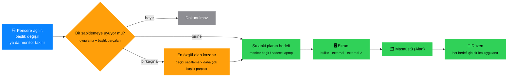
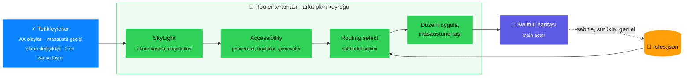

# Başvuru

Her kural, her ayar, her arıza durumu. Genel bakış ve öteki araçlarla
karşılaştırma için [README](../../README.md)’ye, on dakikalık bir tur için
[kullanım kılavuzu](../kilavuz.md)’na bak.

- [Gereksinimler](#requirements)
- [Kurulum](#install)
- [Gerekli macOS ayarları](#required-macos-settings)
- [Hızlı başlangıç](#quick-start)
- [Nasıl çalışır](#how-it-works)
- [Otomasyon (URL şeması)](#automation-url-scheme)
- [Klavye kısayolları](#keyboard-shortcuts)
- [Sorun giderme](#troubleshooting)
- [Mimari](#architecture)
- [Geliştirme](#development)
- [Sınırlar](#limitations)

## Gereksinimler {#requirements}

- macOS 13 Ventura ya da üstü.
- Derlemek için: Swift 5.9 ya da üstüyle Xcode Command Line Tools
  (`xcode-select --install`). Xcode’un kendisi gerekmez.
- Testleri çalıştırmak için: Swift 6 araç zinciri (Xcode 16 ya da onun
  Command Line Tools’u), çünkü testler Swift Testing kullanır.

## Kurulum {#install}

```sh
git clone https://github.com/cnkndmr/Deskmap.git Deskmap
cd Deskmap
make app                      # release derleme → build/Deskmap.app
open build/Deskmap.app    # ya da: make run (derler ve açar)
```

Kalıcı kurulum için uygulamayı `/Applications`’a kopyala ve uygulamanın alt
çubuğunda **Girişte başlat**’ı aç:

```sh
cp -R build/Deskmap.app /Applications/
```

**Girişte başlat** o an hangi kopya çalışıyorsa onu kaydeder. Uygulamayı
`build/` içinden çalıştırıyorsan onay kutusunun ipucu bu yolu gösterir;
kararlı bir giriş öğesi istiyorsan önce uygulamayı `/Applications`’a taşı.
macOS giriş öğesini onaylamanı isterse onay kutusunun yanında turuncu bir
**Onay gerekli** bağlantısı çıkar; Sistem Ayarları › Genel › Giriş Öğeleri’ni
(General › Login Items) açar.

### Erişilebilirlik izni {#accessibility-permission}

Deskmap öteki uygulamaların pencerelerini Erişilebilirlik API’siyle okur ve
taşır, bu yüzden bir kez izin ister:

1. İlk açılışta pencerede **Erişilebilirlik izni gerekli** yazar.
   **İzin ver**’e tıkla.
2. macOS kendi sorusunu gösterir ve Sistem Ayarları › Gizlilik ve Güvenlik ›
   Erişilebilirlik’i (Privacy & Security › Accessibility) açar. **Deskmap**’i
   aç.
3. Uygulama izni 2 saniyede bir denetler ve pencereleri yerleştirmeye
   kendiliğinden başlar. Başlamazsa uygulamadan çık (alt çubuktaki ✕) ve
   yeniden aç.

Uygulama varsayılan olarak ad-hoc imzalıdır. macOS izni kod imzasına bağlar,
bu yüzden **her yeniden derlemeden sonra izni yeniden vermen gerekir**;
bkz. [Sorun giderme](#accessibility-stops-working-after-a-rebuild).

Aynı anda yalnız bir kopya çalışır: ikinci bir Deskmap açılırsa (örneğin
`/Applications` kopyası çalışırken `build/` kopyası) hemen kapanır; böylece
iki Router aynı pencereler için çekişmez.

### Dil {#language}

Arayüz İngilizcedir ve Türkçe çevirisi vardır. Uygulama, tercih ettiğin
diller listesinde (Sistem Ayarları › Genel › Dil ve Bölge; General ›
Language & Region) desteklediği ilk dili kullanır; yani Türkçe ancak listede
İngilizceden önce geliyorsa (ya da İngilizce hiç yoksa) görünür. Dili yalnız
Deskmap için zorlamak istersen:

```sh
defaults write com.deskmap.app AppleLanguages -array en   # ya da: tr
defaults delete com.deskmap.app AppleLanguages            # sistemin sırasına dön
```

Değiştirdikten sonra uygulamadan çık ve yeniden aç.

## Gerekli macOS ayarları {#required-macos-settings}


Deskmap bu ayarları canlı denetler ve hepsi doğru olana dek turuncu bir
**macOS ayarları düzeltilmeli** kartı gösterir. Kartta bir **Masaüstü ve
Dock’u aç** düğmesi var.

**Sistem Ayarları › Masaüstü ve Dock › Mission Control** (System Settings ›
Desktop & Dock › Mission Control):

| Ayar | Olması gereken | Neden |
|---|---|---|
| Alanları en son kullanıma göre otomatik olarak yeniden düzenle (Automatically rearrange Spaces based on most recent use) | **Kapalı** | Açıkken macOS masaüstlerinin sırasını değiştirir: Dock’tan bir uygulamaya geçince komşu bir Alan’a düşersin, pencere bir an görünüp kaybolur ve sabitlemeler yanlış masaüstü numaralarına kayar. |
| Bir uygulamaya geçildiğinde, uygulamanın açık pencerelerinin olduğu bir Alan’a geç (When switching to an application, switch to a Space with open windows) | **Açık** | Kapalıyken Dock’ta bir uygulamaya tıklamak masaüstünü değiştirmez. |
| Pencereleri uygulamaya göre grupla (Group windows by application) | Kapalı (önerilir) | Açıkken Mission Control’deki sıra masaüstü numaralarıyla uyuşmayabilir. |
| Ekranların ayrı Alanları var (Displays have separate Spaces) | **Açık** | Kapalıyken Deskmap harici ekranın masaüstlerini göremez. |

Sabitlediğin her uygulama için **Dock simgesi › sağ tık › Seçenekler › Ata →
Hiçbiri** (Dock icon › right-click › Options › Assign To → None). “Bu
Masaüstü” (This Desktop) ya da “Tüm Masaüstleri” (All Desktops) seçiliyse
macOS pencereyi atadığı Alan’a çeker; bu da Deskmap’in taşımalarıyla
çakışır. Bu ayar kendiliğinden denetlenemez; kart sana hatırlatır,
**Anladım** hatırlatmayı gizler (canlı denetlenen ayarlardan biri değişirse
kart geri gelir).

<br clear="right">

## Hızlı başlangıç {#quick-start}

1. Menü çubuğu simgesine tıkla. Pencerede bir **harita** açılır: her ekran
   için bir kart, her masaüstü için bir satır ve o masaüstündeki pencereler.
2. Bir pencere satırında **raptiye** düğmesine tıkla. Altta bir panel açılır.
3. Başlığın hangi parçasının pencereyi tanıttığını seç; örneğin dosya adı
   yerine proje adı. Panel şu an kaç açık pencerenin uyduğunu gösterir.
   İstersen bir düzen seç (varsayılan, pencerenin şu anki konumu ve
   boyutudur).
4. **Sabitle**’ye tıkla (ya da ⌘Return’e bas). Bundan sonra o uygulamanın,
   başlığında bu parça geçen her penceresi bu masaüstüne, bu düzende gider.
5. Pencereyi başka bir masaüstüne sabitlemek için satırını ya da çipini
   haritada başka bir masaüstü satırına sürükle.
6. Üstteki plan seçicisini değiştir (laptop / monitör, ⌘1 / ⌘2) ve öteki
   kurulum için aynısını yap. İki kurulum birbirinden bağımsızdır.

Etkin profilde hiç sabitleme yokken bu adımları anlatan bir **Başlarken**
kartı görünür.

## Nasıl çalışır {#how-it-works}



### Sabitlemeler (kurallar) {#pins-rules}


Bir sabitleme şunu söyler: *bu uygulamanın, başlığında bu parçalar geçen
pencereleri bu ekrana, bu masaüstüne, bu düzende gider*.

- **Uygulama**: bundle kimliğiyle eşleşir (kimliği olmayan eski kurallarda
  uygulama adıyla).
- **Başlık parçaları**: başlık yaygın ayraçlardan bölünür (` — `, ` – `,
  ` | `, ` · `, ` • ` ve iki yanında boşluk olan ` - ` / ` : `; baştaki
  “kaydedilmemiş” noktası yok sayılır). Başlığı seçili parçaların **hepsini**
  içeren pencere, büyük/küçük harf fark etmeksizin uyar. Varsayılan olarak
  uygulama adı olmayan son parça seçilir, çünkü çalışma alanının adı çoğu
  zaman sondadır.
- **Tüm pencereler**: başlığa bakmadan uygulamanın her penceresini sabitler
  (başlığı olmayan pencerelerde de kendiliğinden kullanılır).
- **Daha özgül olan kazanır**: bir pencereye birden çok sabitleme uyarsa
  başlık parçası daha çok olan kullanılır. Açık bir pencereye uyduğu hâlde
  daha özgül bir sabitlemeye (ya da geçici bir sabitlemeye) yenilen sabitleme
  soluk bir çip olarak görünür; ipucu hangi sabitlemenin önce uyduğunu söyler.
- Var olan bir sabitlemeyle aynı uygulama ve aynı parçalarla sabitlersen
  ikinci bir sabitleme açılmaz, var olan güncellenir.

Deskmap’in uyguladıkları:

- **Masaüstü**: sabit pencere kendi masaüstünde tutulur. Başka bir yere
  düşerse geri taşınır.
- **Düzen**: her pencere ve hedef için bir kez uygulanır. Sonrasında
  pencereyi dilediğin gibi boyutlandırabilirsin; düzen ⌘R’ye (↻) bastığında,
  sabitlemeler değiştiğinde ya da bir ekran değişikliğinden sonra yeniden
  uygulanır. Bakmadığın bir masaüstündeki pencereler düzenini o masaüstüne
  geçtiğinde alır.
- **Şu anki boyutu ve konumu kullan**: sabit bir pencereyi elle
  boyutlandırdıktan ya da taşıdıktan sonra satırına tıkla ve düzen
  düzenleyicisinin altındaki bu düğmeye bas. Pencerenin şu anki konumu ve
  boyutu (ekranının kullanılabilir alanına göre) sabitlemenin kayıtlı
  düzeninin yerine geçer; sabit boyutlu bir sabitlemede ise punto cinsinden
  boyut ve pencerenin değdiği kenarlardan çıkan yaslama noktası (hiçbir kenara
  değmeyen pencere kayıtlı yaslama noktasını korur). Yalnız düzen değişir:
  sabitleme ekranını ve masaüstünü korur, yeni bir sabitleme yazılmaz. Geçici
  sabitlemelerde de çalışır.
- Tam ekran uygulamaların pencerelerine hiç dokunulmaz. Sabitlemesi olmayan
  pencereleri motor hiçbir zaman taşımaz.

Panelini açmak için sabit bir satıra ya da bir çipe tıkla: düzeni değiştir,
**Sabitlemeyi kaldır** ya da başlık parçalarını değiştir (bunun için
sabitlemeye uyan bir pencerenin açık olması gerekir; **Uygula**, başka bir
sabitlemenin uygulamasını ve parçalarını tekrarlayacak bir seçimi kabul
etmez).

<br clear="right">

### “Bu pencere” anahtarları {#this-window-keys}

Sabitleme panelindeki **Bu pencere** seçeneği kararlı bir anahtarla normal,
kayıtlı bir sabitleme yazar; anahtar her uygulama için aynı yolla seçilir:

1. **Dosya yolu** — pencerenin `AXDocument`’ı. Kuralda `"path"` olarak
   saklanır (`tokens` boş kalır); pencere tam olarak o dosyayı göstermelidir.
   Yalnız Deskmap uygulamanın başlığı değişirken belgesinin aynı kaldığını
   gördükten sonra kullanılır (Preview’ın sayfa çevirmesi gibi); bir pencerede
   belgesinin değiştiği görülen uygulamada (VS Code etkin düzenleyiciyi
   bildirir) ya da aynı dosyayı gösteren başka bir açık pencere varken asla
   kullanılmaz. Uygulama başına öğrenilir, yeniden başlatmalarda korunur.
2. **Kararlı başlık parçası** — Deskmap çalıştığı sürece her pencerenin
   başlığını aklında tutar; başlık değişse de aynı kalan parçalar anahtardır.
   Her parça değiştiyse anahtar yoktur. Safari’nin sekme grubu doğrudan araç
   çubuğundan okunur (grup yoksa anahtar da yok).
3. **Temizlenmiş başlık** — henüz bir değişiklik görülmemişse: sayfa
   numaraları, “Edited”, okunmamış sayıları ve benzerleri atılır.

Anahtar yoksa ya da anahtar başka bir açık pencereye de uyuyorsa yalnız
**Uygulamanın bütün pencereleri** sunulur. `deskmap windows` her pencerenin
anahtarını gösterir (`key=file:…`, `key=title:…`, `key=-`).

### Geçici sabitlemeler {#temporary-pins}

Çoklu seçimle sabitlerken (⌘ ile tıkla, **Olduğu yere sabitle**) kullanılabilir
anahtarı olmayan pencereye geçici sabitleme verilir. Geçici sabitleme
pencerenin kimliğini izler: pencere kapanınca ya da uygulaması yeniden
başlayınca biter ve profile kaydedilmez. Pencere açık kaldıkça Deskmap’in
yeniden başlamasından sağ çıkar. Geçici sabitlemelerin simgesi turuncudur ve
normal sabitlemelerden önce gelir.

### İki plan: Monitör bağlı / Sadece laptop {#two-modes-monitor-connected--laptop-only}

Her sabitlemenin her plan için ayrı bir hedefi vardır:

- **Monitör bağlı**: en az bir harici ekran takılı.
- **Sadece laptop**: yalnız dahili ekran.

Plan seçici varsayılan olarak şu an geçerli planı (“şu an”) gösterir; öteki
kurulumu düzenlemek için değiştirebilirsin. Canlı pencereler haritada yalnız
geçerli plan için listelenir; öteki plan sabitlemelerini çip olarak gösterir.
Kenar çubuğundaki *Yeri olmayan pencereler* kutusu iki sekmede de aynıdır
(açık pencereler iki kurulumda da aynı): öteki kurulumun sekmesinde birini bir
masaüstüne bırakmak (ya da raptiyesine basmak) o kurulum için bir sabitleme
açar ve pencereyi taşımaz. Bir monitör takıldığında ya da çıkarıldığında
Deskmap ekranların yatışmasını bekler (2,5 sn, en çok 10 sn) ve sonra bütün
sabit pencereleri yeniden yerleştirir.

Ekranlar seri numarasıyla değil, rolleriyle tanınır: `builtin`, `external`,
`external-2`, … Harici ekranlar soldan sağa numaralanır; aynı sütunda üst
üste duran ekranlar dikey konuma göre (alttaki önce), sonra UUID’ye göre
sıralanır. Ekranı bağlı olmayan sabitleme atlanır.

### Masaüstleri {#desktops}

- **Olmayan masaüstleri**: bir sabitleme 5. masaüstünü hedefliyor ama ekranda
  yalnız 3 masaüstü varsa pencere sonuncusuna gider ve satırda turuncu bir
  **M5→3** rozeti çıkar (İngilizcede **D5→3**). Henüz var olmayan masaüstlerinin
  satırları kesik çizgiyle çizilir. Her ekranın altındaki **+ Masaüstü N**
  satırı gerçek bir masaüstü ekler: Mission Control bir an açılır ve Deskmap
  onun **+** düğmesine basar. Geçerli olmayan kurulumda masaüstü planlanır ve
  o kurulum geçerli olunca açılır. Bir masaüstünü silmek için satırına sağ
  tıkla.
- **Yeniden sıralama**: bir masaüstünün etiketini (“Masaüstü 2”) yukarı ya da
  aşağı sürükle. O ekrandaki bu plana ait bütün sabitlemeler (ve geçici
  sabitlemeler) buna göre yeniden numaralanır ve pencereler taşınır.
- **Sabit olmayan pencereler**: sabit olmayan bir satırı başka bir masaüstüne
  sürüklemek pencereyi bir kez taşır; hiçbir şey kaydedilmez. Tam ekran
  uygulamaların pencereleri hiç taşınmaz ve yeri olmayan pencereler arasında
  listelenmez.
- **Kenar çubuğu**: *Yalnız bir planda yeri olanlar* kutusu bu planda hedefi
  olmayan sabitlemeleri, yalnız bu planda hedefi olan sabitlemeleri ve öteki
  planda başka bir ekrana ya da masaüstüne gönderilen sabitlemeleri listeler.
  Haritadan sabit bir satırı ya da çipi oraya bırakmak onun bu plandaki
  hedefini kaldırır (iki planda da hedefi kalmayan sabitleme silinir); bir
  çipi kutuya geri bırakmak hiçbir şey yapmaz. *Yeri olmayan pencereler* iki
  planda da sabitlemesi olmayan açık pencereleri listeler; menü çubuğu
  simgesi bunların sayısını gösterir.

### Profiller {#profiles}


Profil, adı olan bir sabitleme kümesidir; araç çubuğunun altındaki çipler
profilleri sabitleme sayılarıyla listeler.

- Bir profile geçmek için ona tıkla. Pencereler hemen yeniden yerleştirilir.
- Etkin profile tıklayıp onu yeniden adlandırabilir, **Çoğalt**,
  **Dışa aktar** ya da **Sil** diyebilirsin (son profil silinemez).
- Masaüstü adları, kurulum başına planları ve silinmiş masaüstü satırları her
  profile aittir (şema 6, bkz. [Masaüstü adları](#desktop-names-schema-6)).
  **+** bunlar olmadan başlar; **Çoğalt** bunları kopyalar; profil değiştirmek
  hedef profilin adlarını hemen gösterir, pencereleri onun planına göre taşır
  ve yalnız eksik masaüstlerini açar (hiçbirini silmez). Dışa aktarma
  (sürüm 4) adları, planları ve ad sabitlemelerini taşır (Mac’e özgü masaüstü
  kimliklerini ya da silinmiş masaüstü satırlarını taşımaz); içe aktarılan
  adlar bir sonraki plan uygulamasında plandaki sıralarına göre yerleştirilir.
- **+** boş bir profil açar. İçe aktarma düğmesi daha önce dışa aktarılmış bir
  `.deskmap.json` dosyasını okur; düz bir `rules.json` da olur.
- Profiller Kestirmeler’den (Shortcuts), Raycast’ten ve benzerlerinden
  [URL şemasıyla](#automation-url-scheme) değiştirilebilir.

<br clear="right">

### Geri alma, yineleme ve değişiklik geçmişi {#undo-redo-and-change-history}

Onay pencereleri yok. Bu oturumdaki her ayar değişikliği bir geçmişte bir
adımdır: eklenen, taşınan ya da kaldırılan sabitlemeler, düzenler, başlık
parçaları, masaüstü sırası, profiller (değiştirme, ekleme, yeniden
adlandırma, içe aktarma, silme), yedekler ve başka yerden gelen değişiklikler
(bir URL komutu, komut satırı, Mission Control; bunlar **Ayarlar değişti** ya
da daha özel bir etiketle görünür). Duraklatma anahtarı ve yeni görülen
ekranlar adım sayılmaz.

- **⌘Z** bir adımı geri alır, **⇧⌘Z** bir adımı yineler. Alt çubukta iki
  küçük ↶ ↷ düğmesi durur; üzerine gelince hangi adımı geri alacakları ya da
  yineleyecekleri görünür, yapacak bir şey yokken soluklaşırlar.
- **Son hareketler › Değişiklikler** adımları, en yenisi başta,
  **Deskmap açıldı**’dan başlayarak listeler. Şu anki durumda ● ve **ŞİMDİ**
  vardır; üstündeki soluk satırlar geri alınmıştır ve yinelenebilir. Bir
  satırın üzerine gel ve **Buraya dön**’e tıkla: ayarlar o adımdan hemen
  sonraki hâline tam olarak geri döner (ilk satır açılıştaki durumdur). Geri
  dönmek bir seferde birkaç adım geri ya da ileri gider ve kendi başına adım
  eklemez.
- Geri aldıktan sonra yeni bir değişiklik yapmak geri alınan adımları atar;
  alt çubukta birkaç saniye “Yinelenebilir *N* adım silindi · Geri al” görünür
  ve Geri al onları geri getirir.
- Geçici (oturumluk) sabitleme değişiklikleri geri alınabilir ama
  yinelenemez (“yinelenemez” diye işaretlenir).
- Geçmiş son 50 adımı tutar ve kaydedilmez: Deskmap her açıldığında boş
  başlar. Geri aldığında duraklatma anahtarı ve bilinen ekranlar şu anki
  değerlerini korur.

İmleç bir metin alanındayken ⌘Z / ⇧⌘Z metne uygulanır.

### Duraklatma {#pausing}

Sol üstteki anahtar yerleştirmeyi duraklatır (menü çubuğu simgesi duraklatma
simgesine döner). Pencereler yine listelenir ama hiçbir şey taşınmaz.
Duraklatma kaydedilir ve yeniden başlatmadan sonra da sürer.

### Masaüstü adları (şema 6) {#desktop-names-schema-6}

- Bir ad tek bir masaüstüne (bir macOS Alan kimliğine) bağlıdır ve ekranlar
  arasında, yeniden sıralamada ve takıp çıkarmada onu izler. Adın planı,
  ekranı ya da numarası yoktur.
- Her profilin her kurulum (`docked`, `undocked`) ve ekran rolü için bir
  **planı** vardır: sıralı bir masaüstü listesi, her biri bir ad ya da boş.
  Planın uzunluğu, o rolün kaç masaüstü olması gerektiğidir.
- **Takıp çıkarma** yeni kurulumun planını uygular: adı olan masaüstlerinin
  pencereleri onlarla birlikte taşınır; bir monitör masaüstündeki adsız
  pencereler laptop masaüstlerine park edilir ve monitör yeniden takılınca
  geri döner (ekran rolüne göre, yani başka bir monitör de olur); eksik
  masaüstleri açılır (her geçişte ekran başına en çok 8); yalnız planın
  ötesinde kalan boş masaüstleri silinir ve her biri silinmeden hemen önce
  boş olduğu yeniden denetlenir. Penceresi olan masaüstleri, adı olan
  masaüstleri ve tam ekran alanları hiçbir zaman silinmez ya da taşınmaz.
  Başarısız bir taşıma pencereyi ve masaüstünü yerinde bırakır ve alt çubukta
  bir ileti gösterir.
- Silinmiş masaüstü satırları yalnız gerçekten yapılmış bir silmeden doğar;
  ekran değişikliği, uyku ya da açılışta kaçırılanları yakalama sırasında oluşmaz.
- Bir kural numara yerine bir adı (`nameID`) hedefleyebilir; adın henüz
  masaüstü yoksa pencere bekletilir, taşınmaz. Profil değiştirmek ya da
  **Sadece laptop planını buraya kopyala** pencereleri plana göre taşır ama
  hiçbir şey silmez.
- Penceresi olan bir masaüstünü silmek uygulamada onay ister.
- **Şema 5’ten yükseltme**: ilk yatışmış taramada bir kez çalışır. Eski
  `rules.json` ve `desktop-spaces.json` `Backups/pre-migration/`’a kopyalanır
  (hiç budanmaz; yedek yoksa yükseltme de yok). Adlar, sabit pencerelerinin
  bulunduğu yere göre masaüstleriyle eşleştirilir. Bir durum kartı sonucu
  listeler ve **N boş masaüstünü kaldır** ile **Yükseltmeyi geri al**
  seçeneklerini sunar.

`deskmap desktops` her ad için bir satır yazar: canlı yeri ve her kurulumdaki
planlanan yeri (`external/2  Nova Ek   plan docked: external/2,
undocked: builtin/7`; masaüstü olmayan ad için `(no desktop yet)`); ardından
her plan için bir satır (`plan docked/external: Orion | Nova Ek | · | Lumen`,
`·` = adsız masaüstü), en sonda silinmiş masaüstü satırları. `--json`,
`desktopNames`, `names` ve `plans` yazar.

### Veriler nerede durur {#where-data-lives}

| Dosya | İçerik |
|---|---|
| `~/Library/Application Support/Deskmap/rules.json` | Sabitlemeler, profiller, bilinen ekranlar, açma/kapama anahtarı. Bir değişiklikten 0,4 sn sonra ve çıkışta yazılır. |
| `~/Library/Application Support/Deskmap/rules.json.bak` | Okunamayan ya da kısmen okunamayan bir `rules.json`’ın, üzerine yazılmadan önce alınan kopyası. |
| `~/Library/Application Support/Deskmap/session-pins.json` | Geçici sabitlemeler (pencere kimliği + süreç kimliği). |
| `~/Library/Application Support/Deskmap/desktop-state.json` | Ekran başına masaüstleri, pencereleri (yalnız kimlikler, başlık yok), park edilmiş pencereler ve sürmekte olan geçiş. `desktop-spaces.json`’ın yerini alır; yedeklenmez. |
| `~/Library/Application Support/Deskmap/Backups/` | Otomatik yedekler (bkz. [Yedekler](#backups)). |
| `<name>.deskmap.json` | Dışa aktarılmış bir profil. |

`~/Library/Application Support/Deskmap/` yerine başka bir klasör kullanmak
için `DESKMAP_DATA_DIR`’ı ayarla (bir yükseltmeyi kopya üzerinde denemek
için).

Biçimler için bkz. [docs/architecture.md](architecture.md#data-files).

### Yedekler {#backups}

Uygulama `rules.json`’ı (bütün profiller, sabitlemeler, masaüstü adları ve
planlar) ve varsa `hooks.json`’ı kendiliğinden yedekler: açılışta, çalışırken
beş dakikada bir, uykudan uyanınca ve saat, saat dilimi ya da gün
değiştiğinde. Hiçbir betik ya da launch agent işin içinde değil.

| Klasör | Bir dosya | Saklanan |
|---|---|---|
| `Backups/hourly/hourly-YYYYMMDDTHHZ.json` | her saat için (UTC; yaz saati değişiklikleri çakışmasın diye) | son 24 saat |
| `Backups/daily/daily-YYYY-MM-DD.json` | her yerel gün için; o günün son hâlini tutar | son 7 gün |
| `Backups/weekly/weekly-YYYY-Www.json` | her ISO haftası için; o haftanın son hâlini tutar | sonsuza dek |
| `Backups/pre-restore/pre-restore-…Z.json` | her geri yükleme için; hemen öncesindeki hâl | son 10 |
| `Backups/pre-migration/rules-v5-…Z.json` | şema 5 → 6 yükseltmesi için (bir `desktop-spaces-…Z.json` kopyasıyla) | sonsuza dek |

- Bir dosya yalnız içeriği değiştiyse yeniden yazılır; her yazma önce geçici
  bir dosyaya gider, sonra adı değiştirilerek yerine konur.
- Okunamayan, atlanmış kuralları olan ya da daha yeni bir Deskmap’e ait olan
  bir `rules.json` hiçbir zaman yedeklenmez; boş bir belge (hiç sabitleme
  yok) sabitlemesi olan bir yedeğin yerine hiçbir zaman geçmez.
- Budama yalnız adını tanıdığı dosyaları siler, her katmanın en yeni
  dosyasını korur ve `weekly/`’ye hiç dokunmaz.
- **Geri getirme**: **Ayarlar › Yedekler** (ya da profil panelinde
  **Yedekler…**) → **Geri getir** → **Şimdiki profillerin yerine koy**. Şu
  anki hâl önce `pre-restore/`’a gider, belge değiştirilir (açma/kapama
  anahtarı ve bilinen ekranlar olduğu gibi kalır), `hooks.json` yedekteki
  sürümüne döner ve pencereler yeniden yerleştirilir. Alt çubuk *Yedek geri
  yüklendi · Geri al* sunar. `desktop-state.json` geri getirilmez; içindeki
  masaüstü kimlikleri çalışan oturuma aittir. Şema 5 yedeği geri getirilirken
  yükseltilir.

## Otomasyon (URL şeması) {#automation-url-scheme}

Deskmap `deskmap://` URL’lerini işler; böylece Kestirmeler, Raycast,
Hammerspoon, Keyboard Maestro ya da bir terminal onu yönetebilir. Uygulama
çalışmıyorsa macOS önce onu başlatır.

| URL | Etkisi |
|---|---|
| `deskmap://reapply` | Sabit pencereleri şimdi yerine koy (↻ / ⌘R ile aynı) |
| `deskmap://pause` | Yerleştirmeyi duraklat |
| `deskmap://resume` | Yerleştirmeye devam et |
| `deskmap://toggle` | Duraklat / devam et |
| `deskmap://profile/<name>` | Adı verilen profile geç (önce tam eşleşme, sonra büyük/küçük harf fark etmeksizin) |
| `deskmap://profile?name=<name>` | Aynısı; adında `/` olan profiller için bunu kullan |
| `deskmap://next-profile` | Sıradaki profile geç, sondan başa döner (`next` ve `nextprofile` de olur) |
| `deskmap://add-desktop/<screen>` | Bağlı bir ekrana (`builtin`, `external`, …) masaüstü ekle; Mission Control’ü bir an açar ve **+** düğmesine basar |
| `deskmap://remove-desktop/<screen>/<n>` | Bağlı bir ekranın *n*. masaüstünü Mission Control üzerinden sil; sabitlemeler haritadaki gibi kayar |
| `deskmap://reload` | `rules.json`’ı diskten yeniden oku |
| `deskmap://status` | `status.json`’ı şimdi yaz |
| `deskmap://pin/<window>/<screen>/<n>[?layout=desktop-only]` | Geçici sabitleme: *window* kimlikli pencereyi kapanana dek *screen* ekranının *n*. masaüstünde tut; `desktop-only` konumuna ve boyutuna dokunmaz |
| `deskmap://pin/<window>?name=<desktop name>[&layout=desktop-only]` | Etkin profilin adı olan bir masaüstüne geçici sabitleme; o masaüstünü izler. Bilinmeyen ad hiçbir şey yapmaz |
| `deskmap://unpin/<window>` | Geçici sabitlemeyi kaldır |
| `deskmap://move/<window>/<screen>/<n>` | Pencereyi bir kez taşı |
| `deskmap://rule-add?json=<rule>` | Kural ekle (yüzde kodlanmış kural JSON’ı, `rules.json`’dakiyle aynı biçimde) |
| `deskmap://rule-remove/<id>` | Kural kaldır |
| `deskmap://profile-rename/<name>?name=<new>` | Profili yeniden adlandır |
| `deskmap://profile-export?path=<absolute path>[&name=<profile>]` | Bir profili (varsayılan: etkin olan) `.deskmap.json` olarak dışa aktar |
| `deskmap://desktop-move/<screen>/<n>/<m>[?mode=docked\|undocked]` | *n*. masaüstünü *m*. sıraya taşı, etiketini sürüklemek gibi: sabitlemeler izler; canlı planda pencereler de taşınır |
| `deskmap://rule-save-layout/<rule id>[?window=<id>]` | Uyan bir pencerenin şu anki boyutunu ve konumunu kuralın düzeni yap (canlı plan) |
| `deskmap://profile-set?json=<profile>&activate=1` | Ada göre bir profil oluştur ya da güncelle |
| `deskmap://plan-desktops/<screen>/<count>[?mode=]` | Bir ekranın *count* masaüstü olmasını sağla |
| `deskmap://desktop-name/<screen>/<n>?name=<name>` | Bir masaüstüne ad ver (boş ad adı kaldırır). Ad o masaüstüne aittir: masaüstü yeniden sıralanınca ya da taşınınca, öteki ekrana bile, ve takıp çıkarmada onu izler. Profilde zaten kullanılan bir ad reddedilir |
| `deskmap://quit` | Deskmap’ten çık (betiklerin ve testlerin onu kapatma yolu; süreci asla öldürme) |
| `deskmap://backup-now` | Otomatik yedeklemeyi şimdi çalıştır |
| `deskmap://backup-restore/<id>` | Bir yedeği kimliğiyle geri getir (örn. `daily-2026-10-12`); bkz. [Yedekler](#backups) |

Her komut `?req=<id>` alır: Deskmap komutu işledikten sonra
`"request": "<id>"` ile `status.json` yazar; böylece bir betik komutu
bekleyip `lastError`’ı okuyabilir.

Komut adlarında büyük/küçük harf fark etmez, `deskmap:reapply` (`//`
olmadan) da çalışır. Boşluklar ve ASCII dışı karakterler yüzde kodlanmalıdır:
`Office Desk` → `deskmap://profile/Office%20Desk`. Bilinmeyen bir komut ya da
profil uygulamanın alt çubuğunda kırmızı bir hata gösterir; başka bir
bildirim yoktur.

```sh
open "deskmap://profile/Office"
open "deskmap://reapply"
```

### Komut satırı (`deskmap`) {#command-line-deskmap}

`scripts/deskmap` URL’leri ve `status.json`’ı sarar (`PATH`’ine bağla). Her
komutu bekler ve Deskmap’in hata iletisiyle sıfır olmayan bir kodla çıkar.

```sh
deskmap status                      # plan, profil, ekranlar, sayılar
deskmap windows --app Code          # kimlik, uygulama, ekran/masaüstü, başlık
deskmap move Safari external 2      # pencere kimliği ya da tekil bir uygulama/başlık parçası
deskmap pin 12345 builtin 1 && deskmap unpin 12345
deskmap rule add --app cmux --screen external --undocked-screen builtin --layout 0,0,0.5,1
deskmap rule rm <id>
deskmap pause | resume | reload | profile Office
deskmap profile-rename Office "Office desk"
deskmap export ~/office.deskmap.json [--profile Office]
deskmap desktop-move external 1 3          # 1. masaüstü 3. masaüstü olur
deskmap desktops [--json]                  # adlar, canlı yerleri, her kurulumun planı
deskmap name external 2 "Nova Ek"          # şu an 2. masaüstü olan masaüstüne ad ver
deskmap backups [--json]                   # otomatik yedekler, en yenisi başta
deskmap backup-now
deskmap backup-restore daily-2026-10-12
deskmap save-layout Safari [--window 12345] # az önce sürükleyerek verdiğin boyutu koru
```

### Düzen dosyaları (`deskmap apply`) {#layout-files-deskmap-apply}

Bir kurulumu tek bir dosyada tarif et, Deskmap kursun
(bkz. [`examples/layout.yaml`](../examples/layout.yaml)). Varsayılan olarak
**etkin profil** düzenlenir: dosyadaki pencereler için kurallar eklenir ya da
güncellenir (aynı uygulama + başlık parçaları kuralın kimliğini korur), öteki
her kural kalır. Başka bir profili düzenlemek ya da oluşturmak için
`profile: <name>` ekle (`apply` o profile geçer); dosyayı profilin bütün
kural listesi yapmak için `replace: true` ekle.

```yaml
desktops:
  docked:   {external: 3, builtin: 2}
  undocked: {builtin: 4}
windows:
  - app: Code
    title: Orion-Makale        # başlık parça(lar)ı, isteğe bağlı
    docked: external/1 left-half   # ekran/masaüstü düzeni
    undocked: builtin/1 full
  - app: cmux
    docked: {screen: external, desktop: 2, layout: center-two-thirds}
    launch: true                   # açık penceresi yoksa aç
  - app: Microsoft Teams
    place: builtin/2 center        # iki planda da aynı
```

```sh
deskmap apply desk.yaml --dry-run  # neyin değişeceği (kurallar, masaüstleri, açılışlar)
deskmap apply desk.yaml            # etkin profili (ya da adı verileni) düzenle, rapor ver
deskmap check desk.yaml            # her şey dosyada yazdığı yerde mi? (değişiklik yok)
deskmap apply --undo               # önceki profile ve kurallara dön
deskmap layouts                    # düzen adları: left-half, top-right, center-third…
deskmap apply desk.yaml --remove   # dosyanın kurallarını profilden kaldır
deskmap dump --docked external/2 -o desk.yaml   # var olan kuralları düzen dosyası olarak yaz
```

Rapor, dosyanın kurallarının seçtiği her açık pencereyi listeler (Deskmap’le
aynı seçim: önce geçici sabitleme, sonra başlık parçası en çok olan kural) ve
✓ ya da ✗ ile, nedenini de yazarak işaretler (yanlış masaüstü, boyut
tutmuyor, tam ekran). Bir şey yerinde değilse `apply` 2 koduyla çıkar. Yalnız
bir profil yazılır; öteki profillere hiç dokunulmaz. `--undo` masaüstü
sayılarını geri almaz. `launch`; `true`, uygulamayla açılacak bir dosya/klasör
yolu ya da bir kabuk komutu olabilir. YAML için PyYAML gerekir; `.json`
dosyaları onsuz da çalışır.

`status.json` (`rules.json`’ın yanında) canlı durumu tutar: ekranlar,
yerleşimleri ve geçici sabitlemeleriyle pencereler, kurallar, etkin profil,
yerleştirmenin duraklatılıp duraklatılmadığı ve son hata. `desktopNames`’in
(ekran rolü → numara → ad, şu anki düzen) yanında `names` (`id`, `name`,
`space`, `screen`, `desktop`: masaüstünün şu an nerede olduğu, `planned`:
kurulum → `screen/n`) ve `plans` (kurulum → ekran rolü → ad kimlikleri
listesi, adsız masaüstü için `""`) alanlarını da içerir.

### Ekran değişikliği kancaları (`hooks.json`) {#screen-change-hooks-hooksjson}

Bir pencere başka bir ekrana geçtiğinde Deskmap `hooks.json`’daki
(`rules.json`’ın yanında, değişince yeniden okunur) uyan komutları çalıştırır:

```json
[{"app": "cmux", "from": "*", "to": "builtin", "run": "~/bin/cmux-layout grid"}]
```

`app` bir bundle kimliği ya da uygulama adıdır, `from`/`to` bir ekran rolü
(`builtin`, `external`, …) ya da ekran adı; `*` ya da eksik alan her şeye
uyar. Komut arka planda `/bin/sh -c` ile çalışır (30 sn sonra durdurulur);
şu değişkenleri alır: `DESKMAP_APP`, `DESKMAP_BUNDLE_ID`, `DESKMAP_PID`,
`DESKMAP_WINDOW_ID`, `DESKMAP_FROM`, `DESKMAP_TO` (ve `_NAME` türevleri) ile
`DESKMAP_CAUSE`: `move` (sürüklendi ya da bir kural taşıdı) veya `display`
(bir ekran takıldı ya da çıkarıldı ve macOS pencereyi taşıdı). Fare düğmesi
basılıyken kanca bekler; pencereyi başladığı yere geri bırakmak hiçbir şey
çalıştırmaz. `scripts/hooktest/run.sh` bunu sanal bir ekranla baştan sona
test eder.

- **Kestirmeler**: `deskmap://profile/Home` ile bir **URL’leri Aç** (Open URLs)
  eylemi ekle, sonra ona bir klavye kısayolu ya da bir Odak otomasyonu bağla.
- **Raycast**: `deskmap://toggle` gibi bir **Quicklink** oluştur.
- **Hammerspoon**:

  ```lua
  hs.hotkey.bind({"cmd", "alt"}, "1", function()
    hs.urlevent.openURL("deskmap://profile/Office")
  end)
  ```

## Klavye kısayolları {#keyboard-shortcuts}

Bunlar Deskmap penceresi açık ve öndeyken çalışır.

| Tuşlar | Eylem |
|---|---|
| ⌘R | Sabit pencereleri şimdi yerine koy |
| ⌘1 / ⌘2 | *Monitör bağlı* / *Sadece laptop* kurulumunu göster |
| ⌘Z | Son eylemi geri al (“· Geri al” bağlantısı görünürken) |
| ⌘Return | Sabitleme panelini onayla (**Sabitle**) ya da ⌘ ile tıklanan pencereleri sabitle |
| Esc | Açık paneli kapat ya da ⌘-tık seçimini kaldır (arama alanına ya da bir masaüstü adı alanına yazarken Esc önce alana uygulanır) |

## Sorun giderme {#troubleshooting}

### Yeniden derlemeden sonra Erişilebilirlik çalışmıyor {#accessibility-stops-working-after-a-rebuild}

Belirtiler: izin kartı durmadan geri geliyor ya da Deskmap Sistem
Ayarları’nda açık görünüyor ama hiçbir şey taşınmıyor. Her derleme yeni bir
imzayla ad-hoc imzalanır ve macOS izni eski imza için tutar.

1. Deskmap’ten çık.
2. Sistem Ayarları › Gizlilik ve Güvenlik › Erişilebilirlik’te **Deskmap**’i
   seç ve **−** ile kaldır (kapatıp yeniden açmak çoğu zaman yetmez). Ya da
   bir terminalden: `tccutil reset Accessibility com.deskmap.app`.
3. Yeni derlemeyi aç ve izni yeniden ver.

Kararlı bir kimlikle imzalamak (`SIGN_IDENTITY=... make app`, bkz.
[Dağıtım](#distribution)) bunu önler.

### Pencereler yanlış masaüstüne gidiyor ya da bir an görünüp kayboluyor {#windows-land-on-the-wrong-desktop-or-flash-and-disappear}

macOS ayarları kartına bak: “Alanları en son kullanıma göre otomatik olarak
yeniden düzenle” kapalı olmalı ve uygulamanın Dock’taki **Ata** (Assign To)
ayarı **Hiçbiri** (None) olmalı. Bkz.
[Gerekli macOS ayarları](#required-macos-settings).

### Bir sabitleme devreye girmiyor {#a-pin-doesnt-take-effect}

- Soluk çip: pencereye önce başka, daha özgül bir sabitleme (ya da geçici bir
  sabitleme) uyuyor; hangisi olduğunu görmek için çipin üzerine gel.
- Sabitlemenin ekranı şu anki planda bağlı değil ya da sabitlemenin bu planda
  hedefi yok (kenar çubuğunda *Yalnız bir planda yeri olanlar* altında durur).
- **M5→3** rozeti: hedef masaüstü yok; Mission Control’de masaüstü ekle.
- Pencere tam ekran bir uygulamaya ait.
- Yerleştirme duraklatılmış (sol üstteki anahtar, menü çubuğunda duraklatma
  simgesi).

### “Bu macOS’ta pencereleri masaüstleri arasında taşımak mümkün değil” {#moving-windows-between-desktops-is-not-available-on-this-macos}

Pencereleri Alanlar arasında taşıyan özel SkyLight işlevleri bu macOS
sürümünde bulunamadı. Pencereler yine doğru ekrana ve doğru düzene
yerleştirilir ama masaüstleri arasında taşınmaz.

### “*Uygulama* yanıt vermiyor; geçici olarak atlanıyor” {#app-not-responding-skipped-for-now}

Bir uygulama Erişilebilirlik isteklerine yanıt vermedi (donmuş ya da bir
hata ayıklayıcıda durdurulmuş). Deskmap onu 2 sn atlar, bu süre her seferinde
ikiye katlanarak 30 sn’ye kadar çıkar; böylece tek bir uygulama ötekileri
bekletemez. Yanıt verir vermez kendiliğinden yeniden ele alınır.

### rules.json hataları {#errors-about-rulesjson}

- “*N* kural okunamadı”: bozuk girdiler atlandı; asıl dosya önce
  `rules.json.bak` olarak kaydedildi.
- “rules.json daha yeni bir Deskmap sürümüne ait”: bu dosyayı daha yeni bir
  sürüm yazdı. Eski sürüm onu okur ama üzerine yazmaz; değişiklikler
  kaydedilmez.

### Harici ekran rolleri yer değiştirdi {#external-display-roles-swapped}

İki harici ekranın sol kenarı aynı hizadaysa rolleri (`external`,
`external-2`) dikey konuma göre sıralanır (alttaki ekran önce). Bu sırayı
değiştiren bir güncellemeden sonra etkilenen sabitlemeleri bir kez sürükle;
sıra bundan sonra aynı kalır.

### Günlüğü okumak {#reading-the-log}

Motor birleşik günlüğe (unified log) az ve öz yazar: taşımalar, vazgeçmeler,
yanıt vermeyen uygulamalar, ekran değişiklikleri, uyku/uyanma. Pencere
başlıkları gizlenir.

```sh
log stream --predicate 'subsystem == "com.deskmap.app"' --level info
```

Kategoriler: `routing`, `skylight`, `ax`, `screens`. Açılışta `skylight`
kategorisi SkyLight’ın kullanılabilir olup olmadığını ve bu macOS’un hangi
masaüstü taşıma yöntemini kullandığını bildirir.

## Mimari {#architecture}

```
app/Sources/Deskmap/
├── DeskmapApp.swift      App entry: MenuBarExtra, AppModel, URL delegate, single instance
├── Localization.swift        L(): English keys, Turkish table in app/Resources/tr.lproj
├── Models/
│   ├── Rule.swift            Rule (pin), Destination, WindowLayout, Mode, title splitting
│   ├── Store.swift           Document (rules.json, pure operations), Profile, Store (publishes, saves)
│   └── UndoBuffer.swift      One-level undo
├── Services/
│   ├── Router.swift          The engine: sweeps, moves, layouts, temporary pins
│   ├── Routing.swift         Pure target selection and retry accounting
│   ├── Accessibility.swift   Window list, titles, frames (AX API), unresponsive-app backoff
│   ├── SkyLight.swift        Reading and moving Spaces (private SkyLight calls)
│   ├── ScreenService.swift   Connected displays, roles, settle delay
│   ├── WindowEvents.swift    AX observers and workspace notifications that trigger sweeps
│   ├── URLCommands.swift     deskmap:// parsing and execution
│   ├── MacSettings.swift     Live check of the required macOS settings
│   └── Log.swift             os.Logger categories
└── Views/                    Map, window rows, chips, pin/profile panels, status cards
```



**Router** her 2 saniyede bir ve pencere olaylarının hemen ardından (yeni
pencere, başlık değişikliği, odak değişikliği, masaüstü geçişi) bir tarama
(sweep) yapar. Tarama bir arka plan kuyruğunda çalışır: ekranların
masaüstlerini (SkyLight), pencere sunucusunun listesini ve her uygulamanın
pencerelerini (Accessibility) okur, her pencerenin hedefini
`Routing.select`’le (arayüzün kullandığı işlevin aynısı) seçer, sonra düzeni
uygular ve pencereyi masaüstüne taşır. Sonuçlar main actor’a geri döner,
SwiftUI de onları orada gösterir.

Bir pencereyi başka bir Alan’a taşımanın herkese açık bir API’si yok.
`SkyLight.swift`, Hammerspoon ve yabai’nin de kullandığı özel çağrıları
çalışma zamanında `dlsym` ile çözer (`SLSMoveWindowsToManagedSpace`,
`SLSSpaceSetCompatID` + `SLSSetWindowListWorkspace` ve macOS 26.4+’ta
`SLSBridgedMoveWindowsToManagedSpaceOperation`) ve macOS sürümüne uyanı seçer.
Bir sembol eksikse uygulama çökmez: masaüstü taşımayı atlar, pencereyi yine
doğru ekrana ve doğru düzene yerleştirir.

Daha fazla ayrıntı (tarama adımları, yeniden deneme sınırları, veri
biçimleri, yerelleştirme): [docs/architecture.md](architecture.md).

## Geliştirme {#development}

```sh
make check              # debug derleme
make test               # birim testleri (Swift Testing)
make cli-test           # deskmap CLI birim testleri (Python, uygulamanın çalışması gerekmez)
make concurrency-check  # -strict-concurrency=complete ile derle ve uyarıları listele (yalnız rapor)
make app                # release derleme + build/ içinde .app paketi
make run                # make app, sonra aç
make dist               # dağıtılabilir paket (aşağıya bak)
make clean              # build/ ve app/.build/ klasörlerini sil
```

Testler (`app/Tests/DeskmapTests`, 600 kadar test; tam sayıyı `make test`
yazar) yalnız saf mantığı kapsar: kural eşleştirme (Türkçe İ/ı büyük/küçük harf kuralları dahil) ve
başlık bölme, düzenler ve koordinatlar, `rules.json` şema göçleri,
sabitlemeler ve profiller üzerindeki belge işlemleri, içe/dışa aktarma, hedef
seçimi, yeniden deneme ve geri çekilme yardımcıları, geri almanın
geçerliliği, harita mantığı ve yerelleştirme tutarlılığı. Gerçek pencerelere
hiç dokunmazlar; dosya yazan testler (yedekler, göçler) geçici
bir klasör kullanır.

`make cli-test` (`scripts/clitest`) CLI’nin kendi mantığını aynı biçimde
kapsar: düzen ve yer ayrıştırma, düzen dosyası → kurallar, birleştirme ve
farklar, kural eşleştirme, `check` raporu ve “tamamen örtülebilir” uyarısı.
Uygulamayla konuşan komutları `scripts/hooktest/cli.sh` baştan sona dener;
onun için Deskmap’in çalışıyor olması gerekir.

Swift dosyalarına dokunan her commit’ten önce derleyip test eden pre-commit
kancasını açmak için:

```sh
git config core.hooksPath .githooks
```

CI (`.github/workflows/ci.yml`), `main`’e her push’ta ve pull request’lerde
uygulamayı derler, test eder ve paketler. Sürüm numarası `VERSION`
dosyasından gelir.

`scripts/build-and-run.command` (Finder’da çift tıkla) çalışan Deskmap’ten
çıkar, yeni kopyayı derleyip açar ve çıktıyı `build/last-build.log`’a yazar.

### Yerelleştirme {#localization}

Kullanıcının gördüğü metin `L("English text")` ya da
`L("Format %@ with %ld", value, count)` üzerinden geçer. İngilizce metin
anahtardır; Türkçe çeviri `app/Resources/tr.lproj/Localizable.strings`
içindedir. Bir anahtarın Türkçe karşılığı yoksa, bir Türkçe girdi
kullanılmıyorsa ya da biçim belirteçleri uyuşmuyorsa `LocalizationTests`
başarısız olur. Bkz.
[docs/architecture.md](architecture.md#localization).

### Dağıtım {#distribution}

`make dist` evrensel (arm64 + x86_64) bir `Deskmap.app` derler ve onu
`build/dist/Deskmap-<version>.zip` olarak paketler (DMG için `FORMAT=dmg` ya
da `FORMAT=both`; `VERSION=0.3.1` sürümü geçersiz kılar). Varsayılan imza
ad-hoc’tur: alıcılar uygulamayı ilk kez **sağ tık › Aç** ile açmalı ya da
`xattr -dr com.apple.quarantine /Applications/Deskmap.app` çalıştırmalıdır.
Gatekeeper uyarısı olmadan dağıtmak için bir Developer ID kullan ve notarize
et:

```sh
xcrun notarytool store-credentials notary --apple-id ... --team-id ... --password <app-specific>
SIGN_IDENTITY="Developer ID Application: Name (TEAMID)" NOTARY_PROFILE=notary make dist
```

`scripts/make-dist.command`, `make dist`’i Finder’dan çalıştırır.

## Sınırlar {#limitations}

- **Özel API’ler.** Pencereleri Alanlar arasında taşımak ve öteki
  masaüstlerindeki pencereleri bulmak özel SkyLight ve Erişilebilirlik
  işlevlerine dayanır. Bir macOS güncellemesi bunları bozabilir. Her masaüstü
  taşıması bir sonraki taramada denetlenir; taşımalar art arda etkisiz
  kalırsa Deskmap düşük moda geçer (yalnız ekran ve düzen, masaüstü taşıma
  kapalı) ve **Yeniden dene** düğmeli bir kart gösterir.
- **Doğrulanmamış sürümlerde masaüstü taşıma kapalı başlar.** macOS 15.x ve
  macOS 26.0–26.3’te masaüstü taşıma doğrulanmadı; bu yüzden baştan kapalıdır
  ve bir kart bunu söyler, ekran ve düzen yine uygulanır. **Yine de dene**
  taşımayı açar (hatırlanır); taşımalar sonra da etkisiz kalırsa yukarıdaki
  düşük mod devreye girer.
- **Durum bilinmiyorsa dokunulmaz.** macOS bir pencerenin hangi masaüstünde
  olduğunu söylemezse pencere yalnız listelenir: ne taşınır ne
  boyutlandırılır.
- **Masaüstleri Mission Control üzerinden eklenir.** macOS’ta masaüstü
  oluşturmanın herkese açık bir yolu yok; bu yüzden Deskmap Mission Control’ü
  bir an açar ve onun **+** düğmesine basar. Son masaüstünün ötesindeki
  sabitlemeler sonuncusuna gider.
- **Başlık pencereyi tanıtmalı.** Başlığında çalışma alanı ya da belge adı
  göstermeyen uygulamalar yalnız uygulama çapında ya da geçici
  sabitlemelerle sabitlenebilir.
- **Tam ekran pencerelere** dokunulmaz.
- **Yalnız iki kurulum**: monitör bağlı / sadece laptop. Harici ekranlar
  model ya da seri numarasıyla değil, konumlarıyla (soldan sağa) tanınır.
- **Anında değil.** Yerleştirme pencere olaylarında olur. 5 saniyede bir
  yapılan hafif bir denetim olayların kaçırdığını yakalar (tam tarama yalnız
  bir şey değiştiğinde, bir de iki dakikada bir); başlık değişiklikleri bir
  saniye toplanır ve yalnız başlığa dayalı sabitlemesi olan uygulamalarda
  sayılır. Yavaş boyutlanan uygulamalara birkaç deneme daha tanınır.
- **Tek düzeyli geri alma**, 10 saniye görünür.
- Varsayılan olarak **ad-hoc imza**; bu yüzden her yeniden derlemeden sonra
  Erişilebilirlik izni yeniden verilmelidir.
- **Diller**: İngilizce ve Türkçe.

## Lisans {#license}

MIT; bkz. [LICENSE](../../LICENSE).
